# PartsBin — Parts-to-Projects

Tell PartsBin which electronics parts are lying in your drawer (or just **show it a photo**), add a few
constraints, and it designs **three buildable DIY projects** for you — each with a full parts list that
marks what you already own and what you'd have to buy, step-by-step build instructions, an estimated
build time and a price for the missing parts.

It's the "Fridge-to-Recipes" homework with a different fridge: **parts instead of ingredients, projects
instead of recipes** — plus a few things that make it more than a prompt wrapped in a CLI.

The built-in gallery has **20 small builds** you can make in an afternoon or two: robotics (an ultrasonic radar,
robot cars, a robot arm, walking robots), home gadgets (smart trash can, pet feeder, weather station) and
security / home-network projects (Pi-hole ad blocker, home VPN, DIY security key, RFID lock, alarms).

```
parts you own ─┐                     ┌─ 3 projects, each with:
photo of bin ──┼──▶  LLM  ──▶ verify ┼─   ✓ owned / ✗ missing parts (+ CZK price)
constraints ───┘      ▲          │   ├─   step-by-step build instructions
                      └─ repair /─┘   ├─   estimated build time
                         regenerate   └─   constraint checks + shopping list
```


**New here?** Start with the [tutorials](docs/README.md), or browse the [gallery](#gallery) below.

## Features

| | |
|---|---|
| 📷 **Photo → parts list** | A vision call detects components in a photo of your parts bin. You confirm or edit the list before anything is generated. |
| 🧮 **Missing parts computed in code, not by the LLM** | Every part name (yours and the model's) is mapped to a canonical key through an alias catalog (`"9g micro servo"`, `"SG90"` and `"servo"` are the same part, but `"MG996R servo"` isn't). Quantities count: own 2 servos, need 4 → *have 2, missing 2*. |
| 💰 **Cost of missing parts** | Indicative CZK prices from an editable catalog (`data/parts-catalog.json`). Unknown items (popsicle sticks…) are listed as unpriced instead of guessed. |
| ✅ **Self-check loop** | After generation the app verifies every constraint itself (skill, time, budget, soldering, "uses your parts", mains-voltage safety). Projects that fail are regenerated *individually* with the reasons fed back to the model; the better version is kept. |
| 🧾 **Validated structured output** | The model answers in JSON Schema-constrained output; [zod](https://zod.dev) validates it. Invalid output is sent back with the validation errors so the model can repair it. |
| 🔁 **Retries done properly** | Exponential backoff with full jitter on transient failures only (429, 5xx, 529 overloaded, timeouts, network errors), honours `Retry-After`. Permanent errors (401 bad key, 400, 404 model) fail immediately with a helpful message. |
| 🔌 **Provider-agnostic** | Anthropic (default), any OpenAI-compatible API (OpenAI, OpenRouter, Groq, local Ollama…), or an offline **mock** provider for trying it without a key. No LLM SDK — the HTTP layer is ~150 lines of `fetch`. |
| 🖼 **Parts pictures** | Every project, including ones the AI just invented, gets a generated illustration of its parts: solid cards for what you own, dashed red "BUY ~60 Kč" cards for what's missing. 60+ hand-drawn component icons. |
| 📚 **Gallery of 20 small projects** | Robotics (radar, obstacle-avoiding and Bluetooth cars, robot arm, walkers, laser cat toy), home gadgets (smart trash can, pet feeder, weather station, theremin) and security builds (Pi-hole, VPN, security key, RFID lock, alarms, doorbell). Ranked against *your* parts, with real photos. Works offline, no API key. |
| 📘 **Tutorials + example code** | Eight step-by-step guides, including four complete builds: Pi-hole ad blocker, RFID lock, ultrasonic radar and air theremin, with Arduino and Python code ([docs](docs/README.md)). |
| 🖥 **CLI + web UI** | Coloured terminal output, `--json`, Markdown shopping-list export, SVG export, and a web UI with photo drag-and-drop, a gallery and a "how it works" page. |
| 🧪 **Tested** | 29 unit tests: part matching, quantity parsing, retry/backoff, repair loop, constraint regeneration, HTTP client against a stubbed `fetch`, gallery data, illustrations. |

## Setup

Requires **Node.js 20.12+** (uses built-in `fetch`, `process.loadEnvFile` and `node:test`).

```bash
git clone <this repo> && cd partsbin
npm install
cp .env.example .env      # then put your API key into .env
```

Try it without any key first:

```bash
LLM_PROVIDER=mock npm start -- "raspberry pi zero 2 w, microsd card, esp32, oled" --skill beginner
```

(Windows PowerShell: `$env:LLM_PROVIDER="mock"; npm start -- "raspberry pi zero 2 w, microsd card, esp32, oled" --skill beginner`.)
The mock provider answers from the gallery, so it's also the fastest way to demo the app.

## Environment variables

Configuration lives in `.env` (loaded automatically, **git-ignored — never commit it**). `.env.example` is the template.

| Variable | Required | Default | Meaning |
|---|---|---|---|
| `LLM_PROVIDER` | no | `anthropic` | `anthropic`, `openai` (any OpenAI-compatible API) or `mock` (offline) |
| `ANTHROPIC_API_KEY` | if provider = anthropic | — | Your Anthropic API key |
| `OPENAI_API_KEY` | if provider = openai¹ | — | API key for the OpenAI-compatible server |
| `OPENAI_BASE_URL` | no | `https://api.openai.com/v1` | e.g. `http://localhost:11434/v1` for Ollama |
| `LLM_MODEL` | if provider = openai | `claude-sonnet-5-5` for anthropic | Model name |
| `LLM_TIMEOUT_MS` | no | `60000` | Timeout per request attempt |
| `LLM_MAX_RETRIES` | no | `3` | Retries after the first attempt (transient errors only) |
| `PORT` | no | `3000` | Web UI port |

¹ Not needed for local servers like Ollama.

### Free providers (no Anthropic account needed)

**Groq** (free key from [console.groq.com](https://console.groq.com) → API Keys), which is what the example run below uses:

```dotenv
LLM_PROVIDER=openai
OPENAI_API_KEY=gsk_...
OPENAI_BASE_URL=https://api.groq.com/openai/v1
LLM_MODEL=openai/gpt-oss-120b
```

**Ollama** (runs on your own computer, no key; install from [ollama.com](https://ollama.com), then `ollama pull qwen3:8b`):

```dotenv
LLM_PROVIDER=openai
OPENAI_BASE_URL=http://localhost:11434/v1
LLM_MODEL=qwen3:8b
```

OpenAI-compatible servers are asked for JSON mode (`response_format: json_object`); the app validates every answer
with zod and sends any errors back to the model to fix, so smaller models work too.

## Usage

### CLI

```bash
npm start -- [parts...] [options]
# or, after `npm link`:  partsbin [parts...] [options]
```

| Option | |
|---|---|
| `"arduino uno, 4x sg90, …"` | Parts, comma / newline separated. Quantities: `4x servo`, `servo x4`, `servo (4)`, `4 servos` |
| `--parts-file <file>` | Text file, one part per line |
| `--photo <image>` | Detect parts from a photo (jpg/png/webp/gif). Asks you to confirm; `--yes` skips that |
| `--goal <text>` | Theme, e.g. `"block ads on my network"` |
| `--skill <level>` | `beginner` \| `intermediate` \| `advanced` |
| `--hours <n>` | Max build time |
| `--budget <czk>` | Max spend on missing parts |
| `--no-solder` | Solderless builds only |
| `--gallery` | List the example projects, ranked by your parts if you give any (no API key needed) |
| `--project <id>` | Show one example project in full, checked against your parts |
| `--json` | Raw JSON output |
| `--out <file>` | Also save the whole run (progress + results) as a UTF-8 text file |
| `--shopping-list <file>` | Write a Markdown shopping list |
| `--svg-dir <dir>` | Save a parts picture (SVG) for every project |
| `--provider <name>` | Override `LLM_PROVIDER` for one run |

Exit codes: `0` success, `1` runtime/API error, `2` bad arguments.

### Web UI

```bash
npm run web        # → http://localhost:3000
```

Type or photograph your parts (or click one of the example kits), set constraints, and get three project
cards with a parts picture, owned/missing parts, steps, constraint checks and a downloadable shopping list.
The **Gallery** tab shows the example projects ranked against your parts; **How it works** explains the cards.

| Gallery | Project from the gallery | On a phone |
|---|---|---|
| 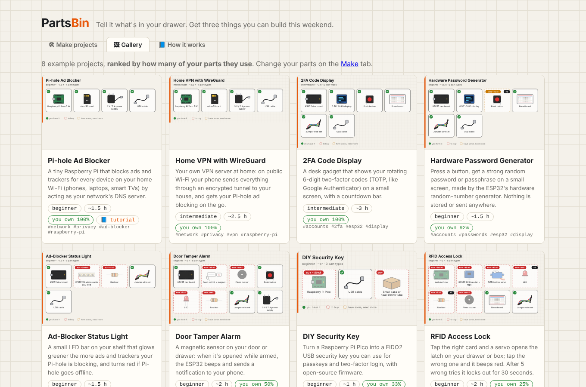 | 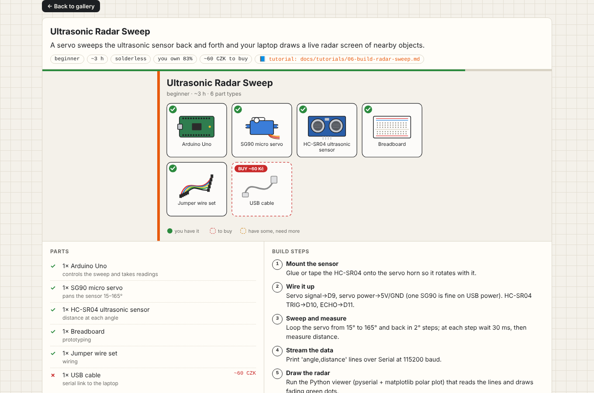 | 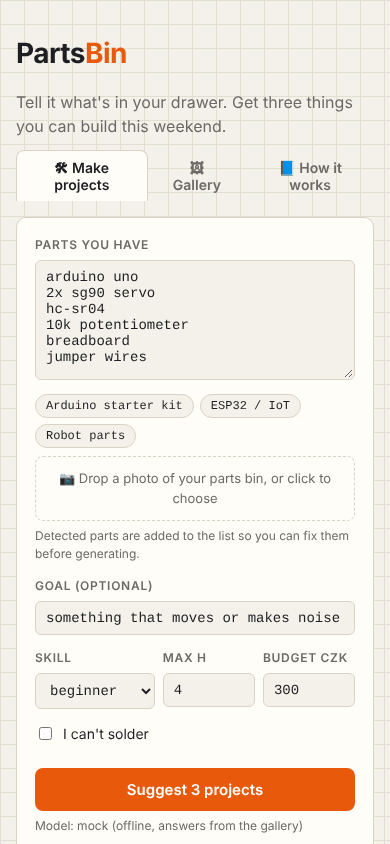 |

The terminal version:

| `npm start -- "…parts…" --skill beginner …` | `npm start -- --gallery "…parts…"` |
|---|---|
|  |  |

## Gallery

20 small, mostly beginner builds ship with the app (`data/showcase.json`): **robotics** (radar, robot cars,
robot arm, walkers), **home gadgets** and **security / home-network projects**. See them with `npm start -- --gallery`
or in the web UI. Each one is a complete build: parts with purposes, numbered steps, time, difficulty and safety notes.

Photos show the finished result or a similar real build (openly licensed, from Wikimedia Commons, see
[credits](docs/images/photos/CREDITS.md)); the parts drawings are generated by the app.

| Photo | Project | Parts | Level | Guide |
|---|---|---|---|---|
| 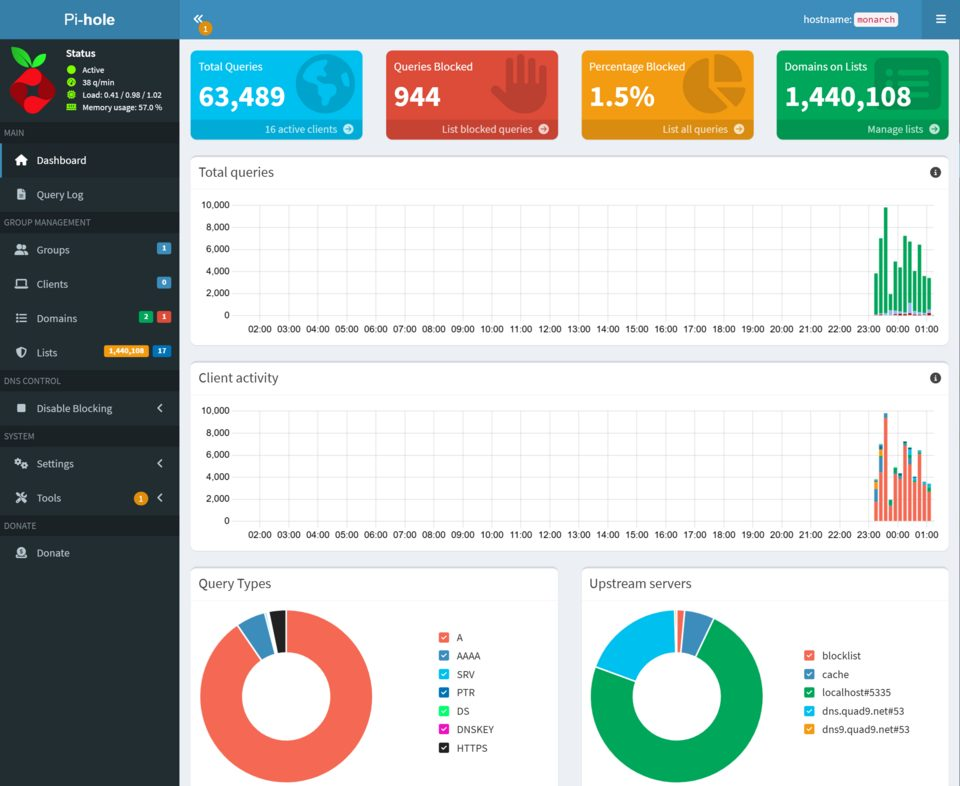<br><sub>The finished result: the Pi-hole dashboard (real screenshot)</sub> | **Pi-hole Ad Blocker**<br>A tiny Raspberry Pi that blocks ads and trackers for every device on your home Wi-Fi (phones, laptops, smart TVs) by acting as your network's DNS server.<br>`--project pi-hole` | 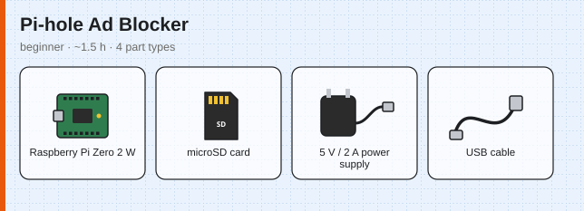 | beginner · ~1.5 h | [📘 build guide](docs/tutorials/05-build-pi-hole.md) |
| 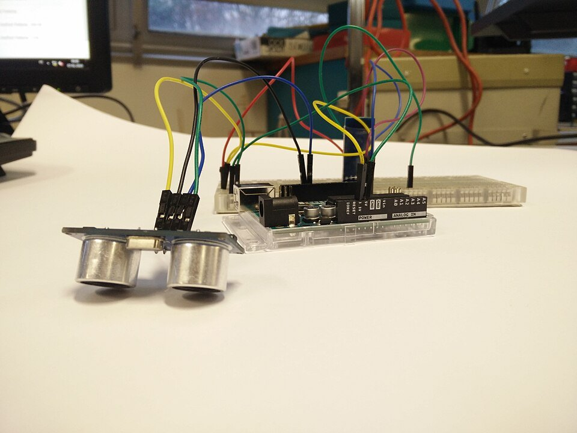<br><sub>The heart of the radar: an Arduino with an HC-SR04 ultrasonic sensor</sub> | **Ultrasonic Radar Sweep**<br>A servo sweeps the ultrasonic sensor back and forth and your laptop draws a live radar screen of nearby objects.<br>`--project radar-sweep` | 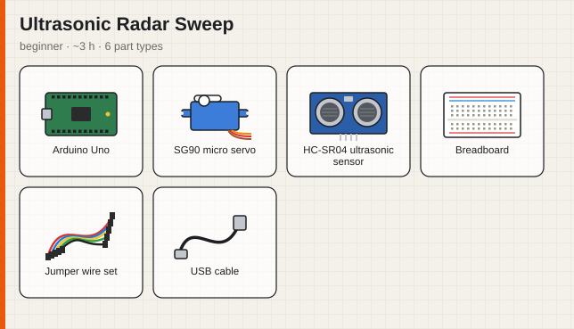 | beginner · ~3 h | [📘 build guide](docs/tutorials/07-build-radar-sweep.md) |
| 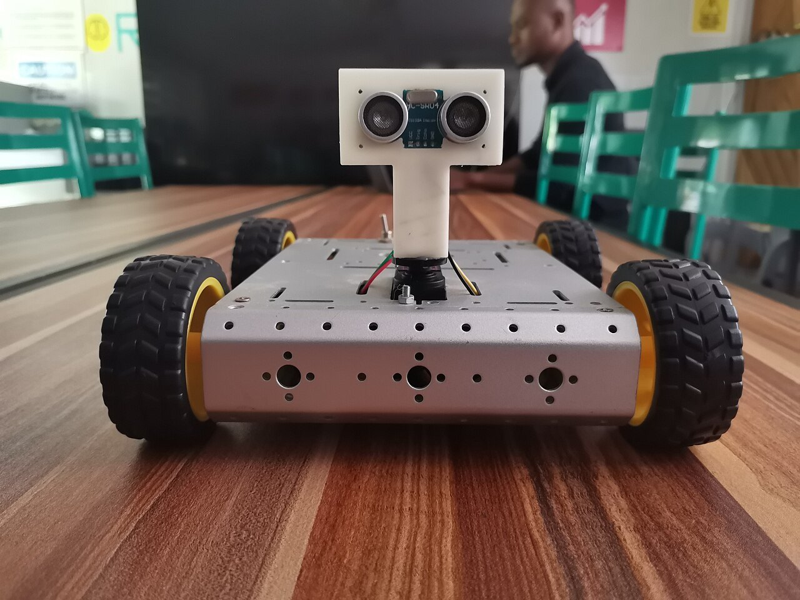<br><sub>A similar real build: an Arduino obstacle-avoidance robot car</sub> | **Obstacle-Avoiding Robot Car**<br>A two-wheeled robot that drives around on its own: when its ultrasonic 'eyes' see a wall, it stops, looks left and right, and turns toward the side with more space.<br>`--project obstacle-car` | 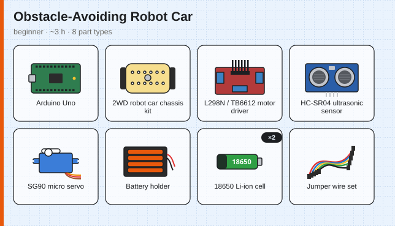 | beginner · ~3 h |  |
| 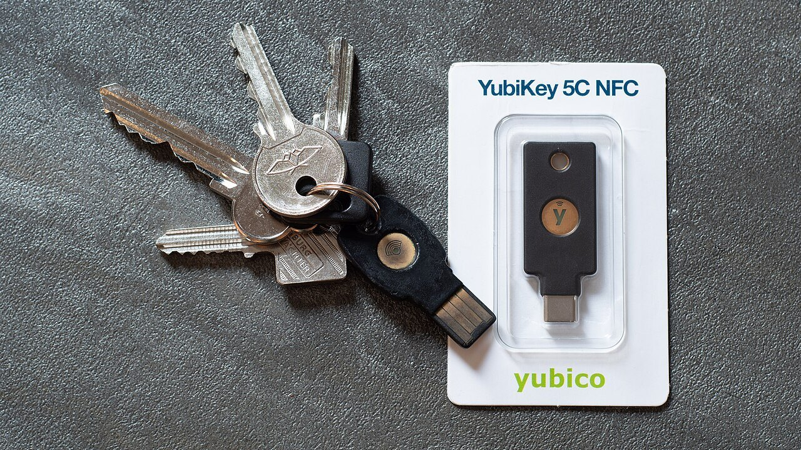<br><sub>A shop-bought FIDO2 security key (YubiKey), the product this project rebuilds</sub> | **DIY Security Key**<br>Turn a Raspberry Pi Pico into a FIDO2 USB security key you can use for passkeys and two-factor login, with open-source firmware.<br>`--project security-key` | 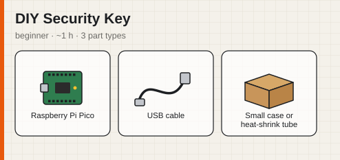 | beginner · ~1 h |  |
| 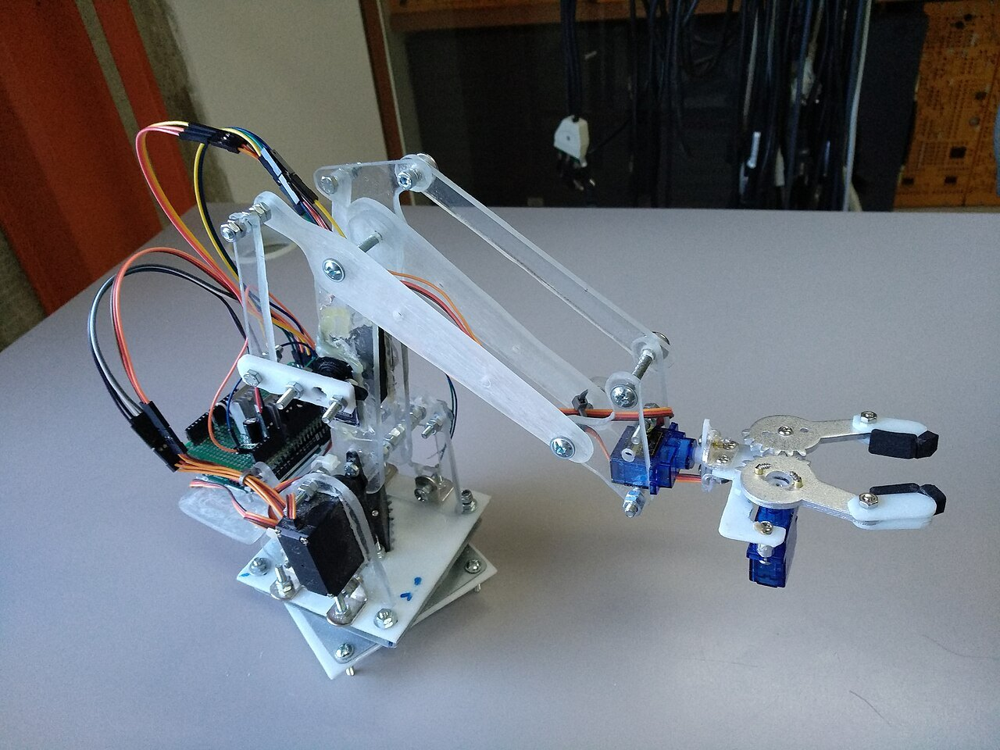<br><sub>A similar real build: an Arduino robot arm (5 joints)</sub> | **Mini Robot Arm**<br>A 4-servo desk robot arm you control with four knobs, and it can record your moves and replay them on its own at the press of a button.<br>`--project robot-arm` | 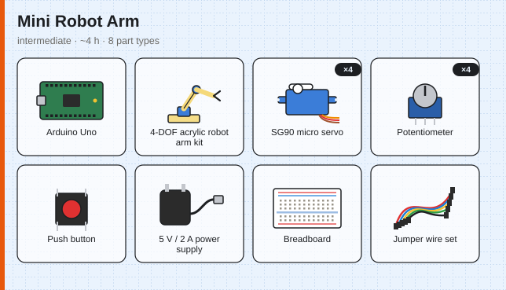 | intermediate · ~4 h |  |
| 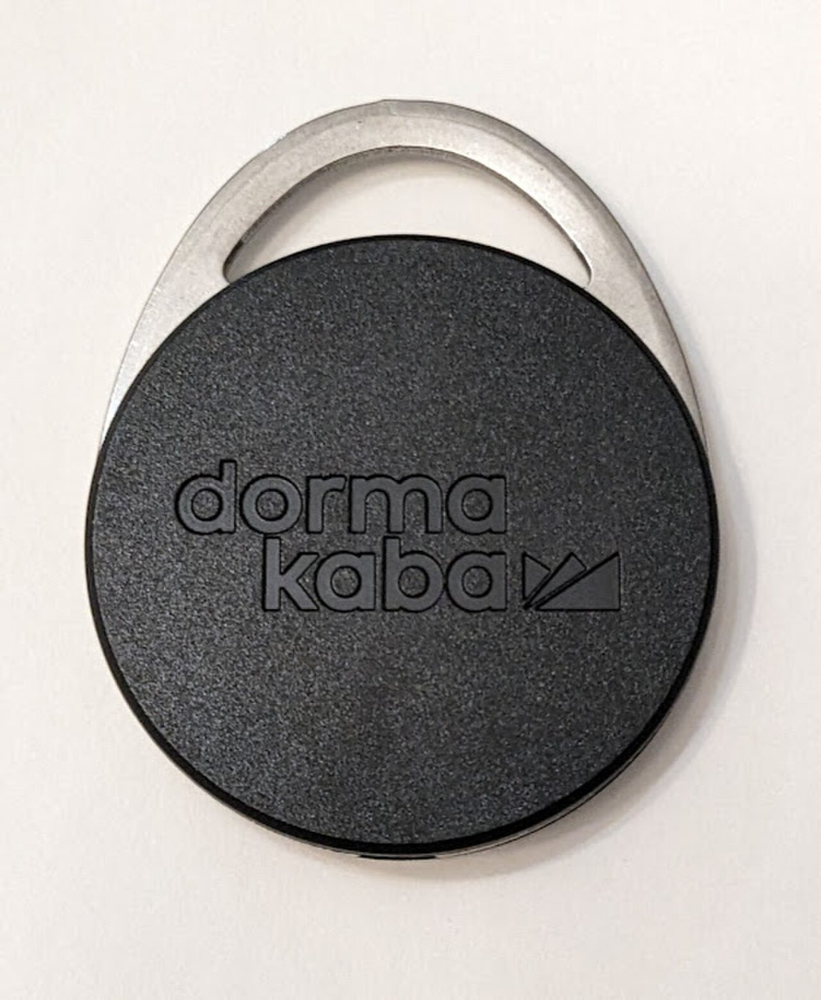<br><sub>An RFID key fob from a real door-access system</sub> | **RFID Access Lock**<br>Tap the right card and a servo opens the latch on your drawer or box; tap the wrong one and it beeps red. After 5 wrong tries it locks out for 30 seconds.<br>`--project rfid-lock` | 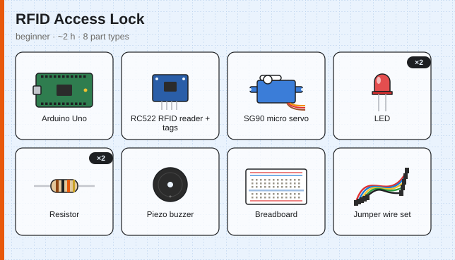 | beginner · ~2 h | [📘 build guide](docs/tutorials/06-build-rfid-lock.md) |
| 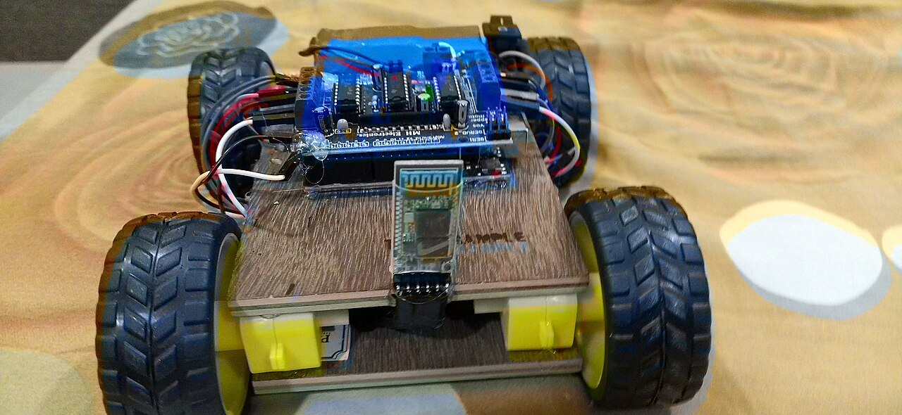<br><sub>A similar real build: an Arduino car controlled over Bluetooth</sub> | **Bluetooth RC Car**<br>Drive a little robot car from your phone: a free Bluetooth controller app sends forward, back, left and right to the Arduino.<br>`--project bluetooth-car` | 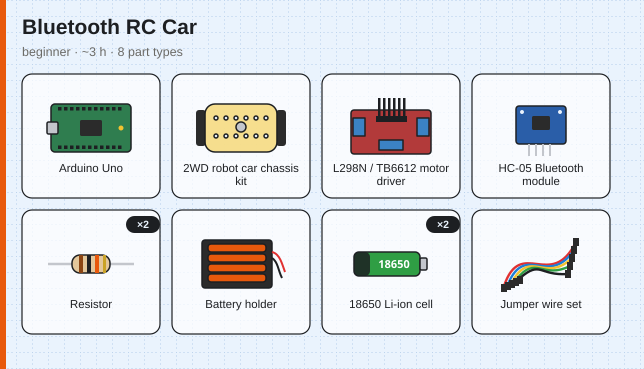 | beginner · ~3 h |  |
| 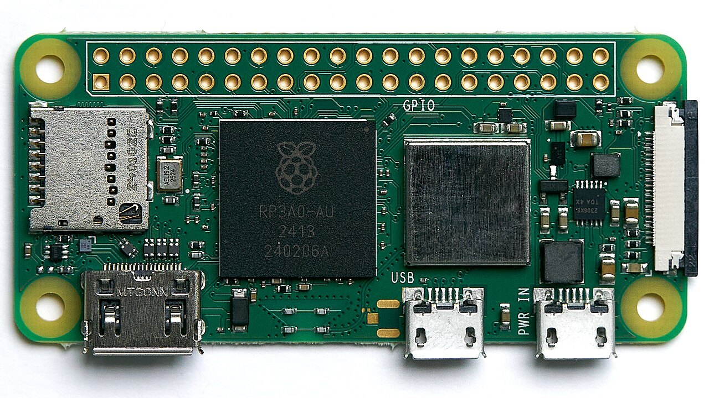<br><sub>The Raspberry Pi Zero 2 W that runs the VPN</sub> | **Home VPN with WireGuard**<br>Your own VPN server at home: on public Wi-Fi your phone sends everything through an encrypted tunnel to your house, and gets your Pi-hole ad blocking on the go.<br>`--project home-vpn` | 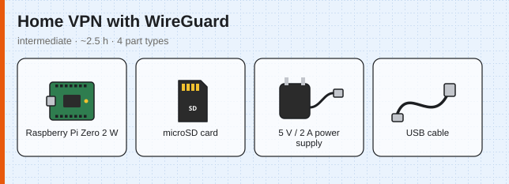 | intermediate · ~2.5 h |  |
| 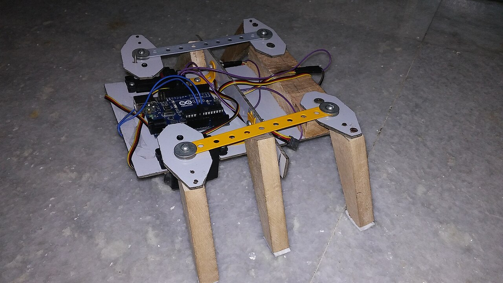<br><sub>A similar real build: a small 3-servo walking robot</sub> | **Desk Crab — a 4-servo walking robot**<br>A palm-sized quadruped that shuffles across your desk and backs away from obstacles it 'sees' with the ultrasonic sensor.<br>`--project desk-crab` | 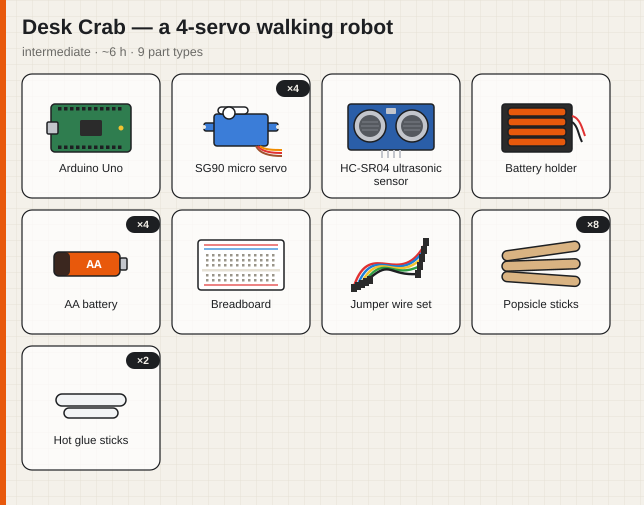 | intermediate · ~6 h |  |
| 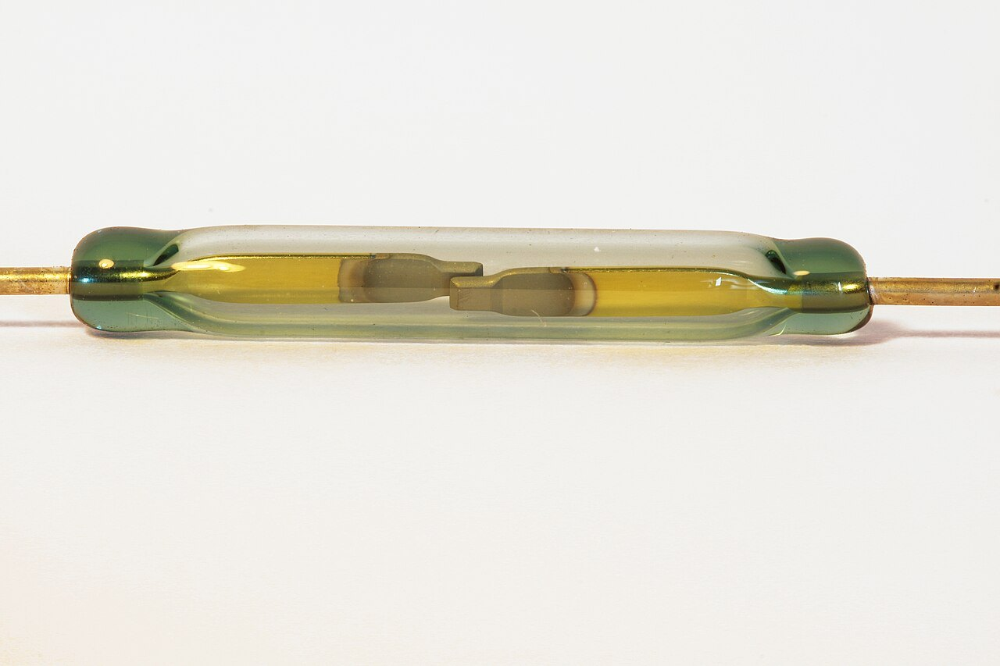<br><sub>Close-up of a reed switch, the sensor at the heart of the door alarm</sub> | **Door Tamper Alarm**<br>A magnetic sensor on your door or drawer: when it's opened while armed, the ESP32 beeps and sends a notification to your phone.<br>`--project door-alarm` | 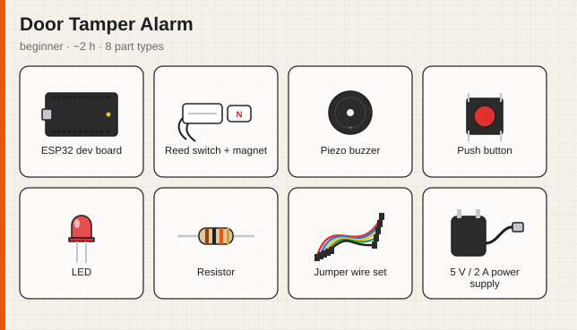 | beginner · ~2 h |  |
| 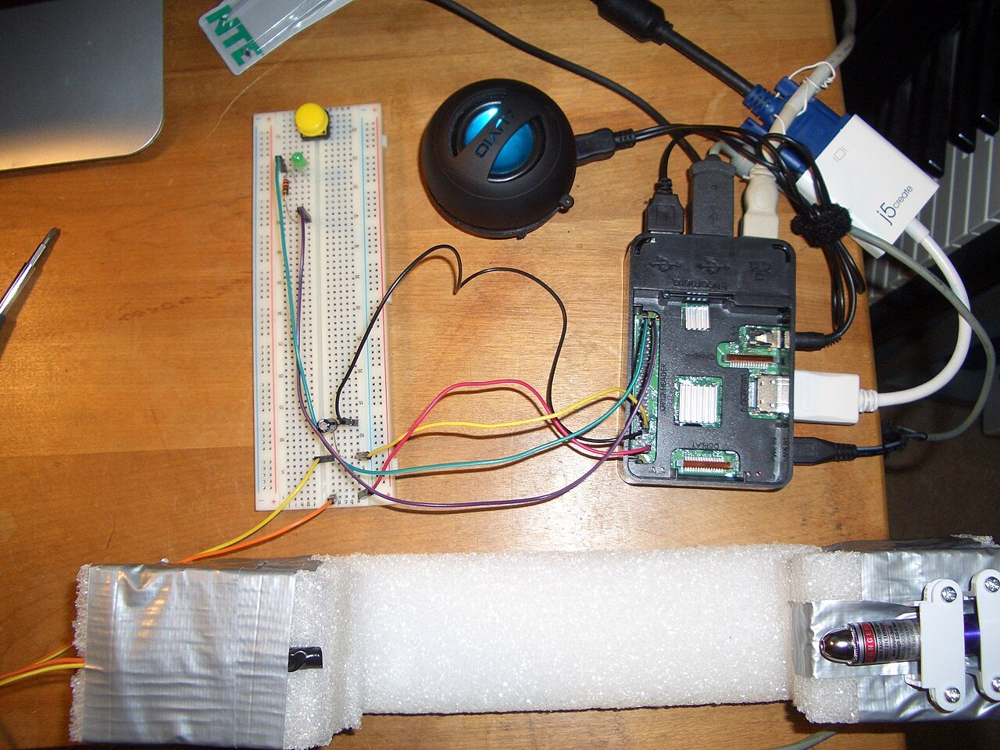<br><sub>A similar real build: a home-made laser tripwire with an alarm</sub> | **Laser Tripwire Alarm**<br>A laser beam across a doorway hits a light sensor on the other side. When someone walks through and breaks the beam, a buzzer sounds until you reset it.<br>`--project laser-tripwire` | 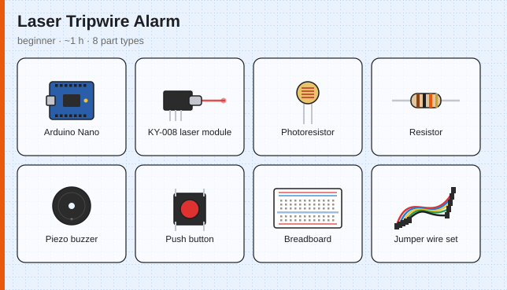 | beginner · ~1 h |  |
| 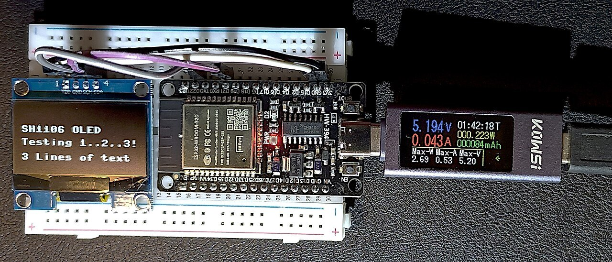<br><sub>A similar build: an ESP32 with a small OLED screen on a breadboard</sub> | **Hardware Password Generator**<br>Press a button, get a strong random password or passphrase on a small screen, made by the ESP32's hardware random-number generator. Nothing is stored or sent anywhere.<br>`--project password-generator` | 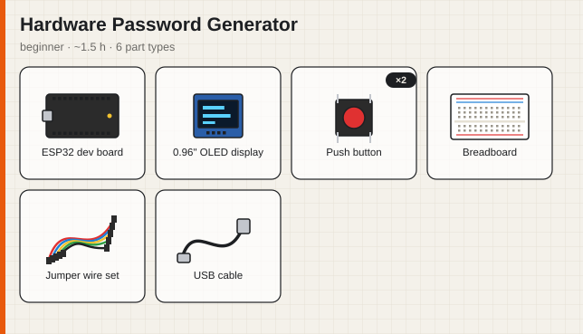 | beginner · ~1.5 h |  |
|  | **Smart Trash Can**<br>Wave your hand near the bin and the lid opens by itself; it closes gently a few seconds after you're done. No more touching a dirty lid.<br>`--project smart-trash-can` | 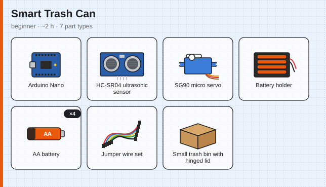 | beginner · ~2 h |  |
| 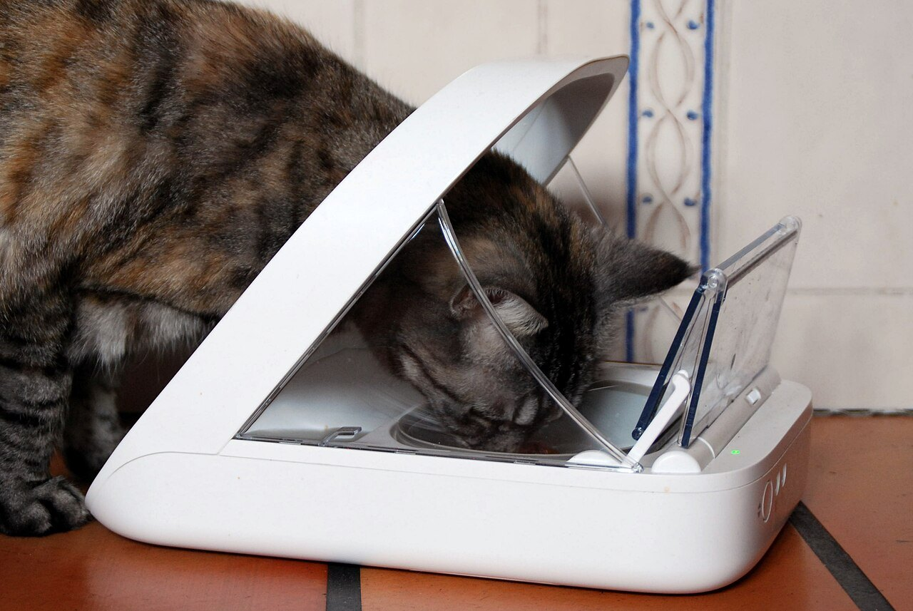<br><sub>A shop-bought automatic cat feeder, the product this project rebuilds</sub> | **Automatic Pet Feeder**<br>A food container with a servo flap that drops a portion at set times every day, plus a button for an extra snack (limited to a few per day).<br>`--project pet-feeder` | 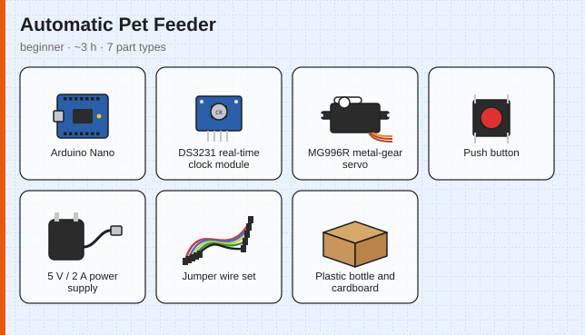 | beginner · ~3 h |  |
|  | **Laser Cat Toy**<br>A tiny pan-tilt turret that moves a laser dot around the floor in random paths for five minutes, so your cat can hunt it.<br>`--project laser-cat-toy` | 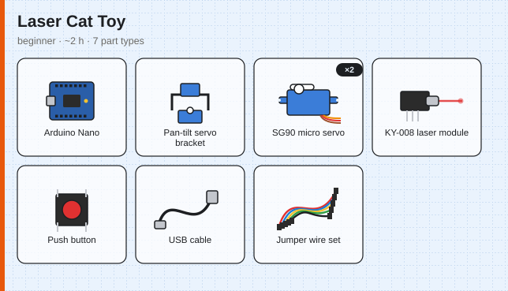 | beginner · ~2 h |  |
| 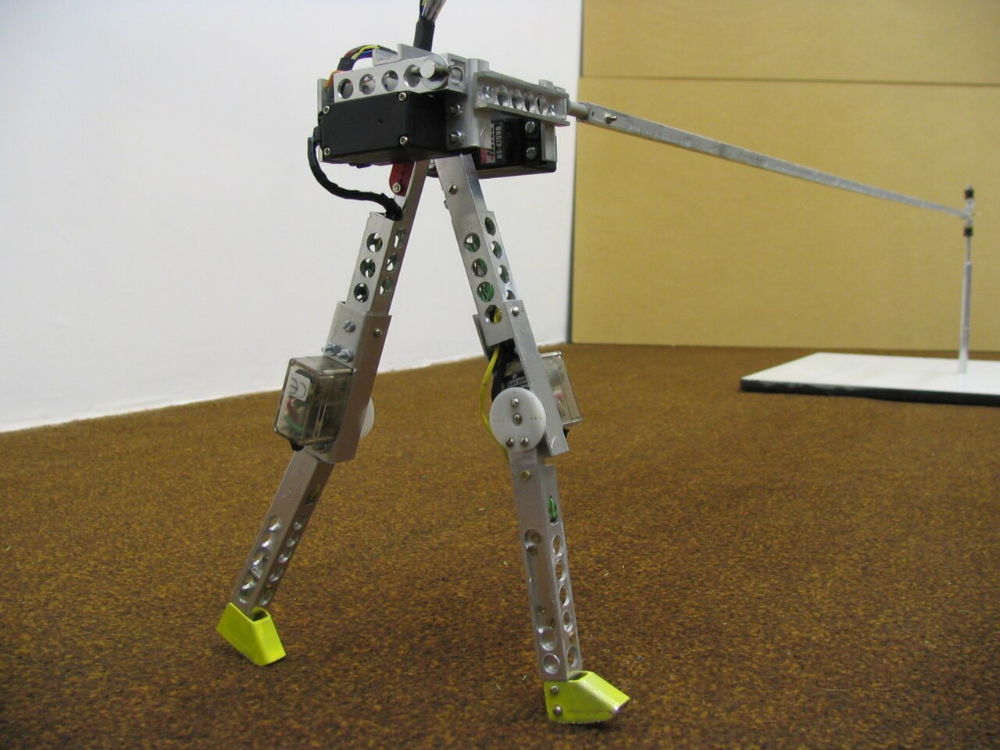<br><sub>A similar real build</sub> | **Mini Biped Walker**<br>A small two-legged robot with hips and ankles that waddles forward, dances and turns away from walls — a first step towards a bigger walking robot.<br>`--project mini-biped` | 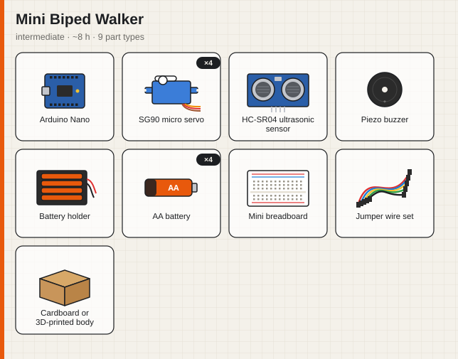 | intermediate · ~8 h |  |
| 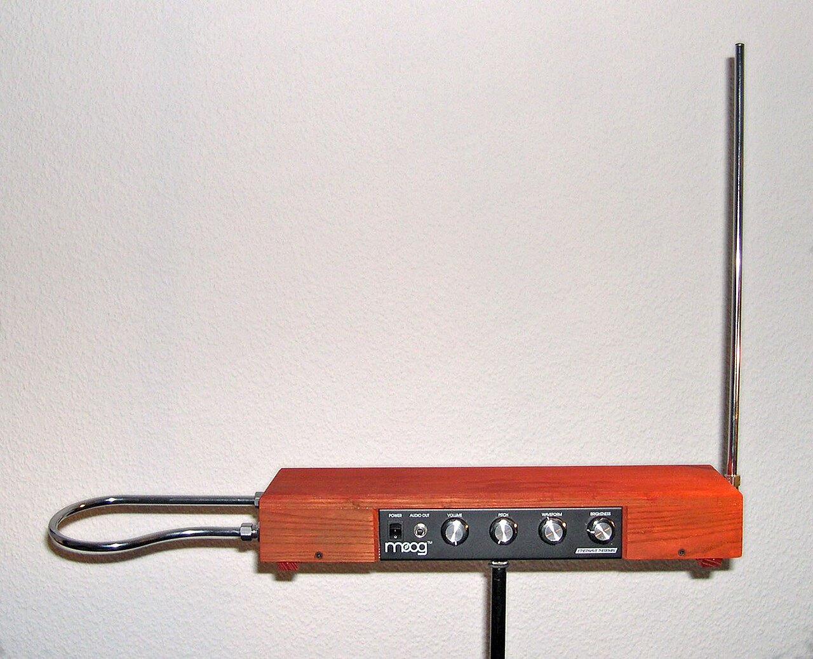<br><sub>A similar real build</sub> | **Air Theremin**<br>Play notes by moving your hand above an ultrasonic sensor; a potentiometer picks the musical scale.<br>`--project air-theremin` | 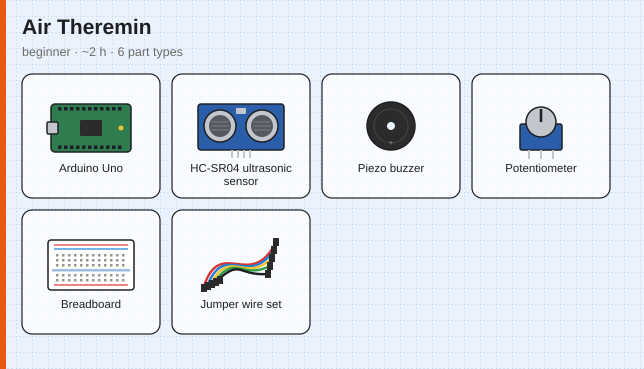 | beginner · ~2 h | [📘 build guide](docs/tutorials/08-build-air-theremin.md) |
| 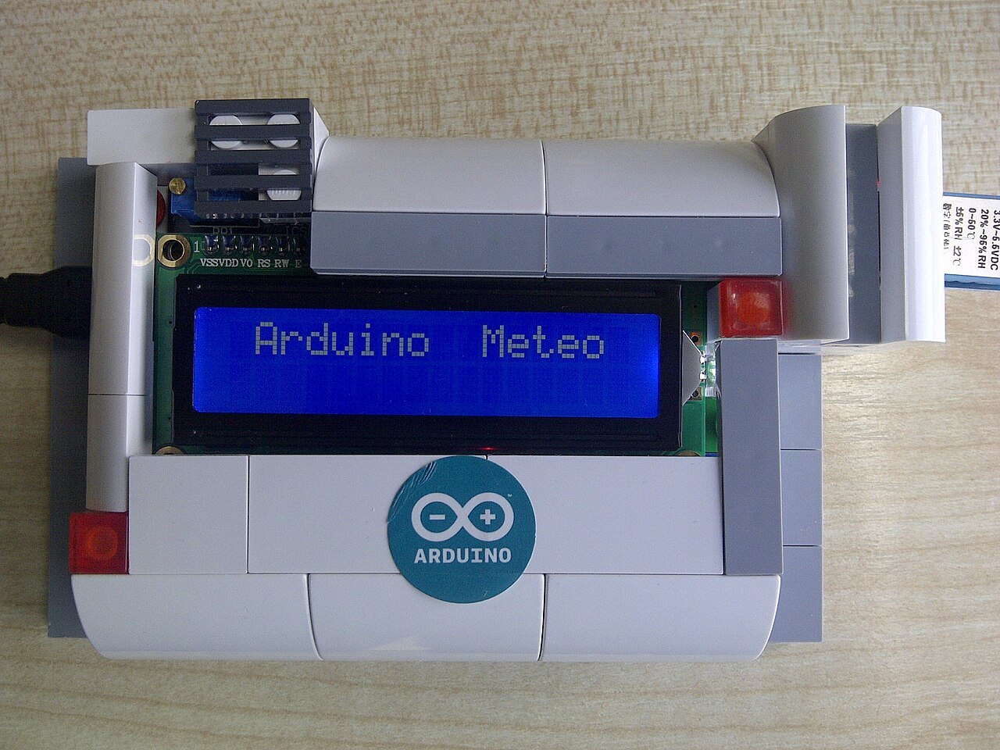<br><sub>A similar real build: an Arduino weather station in a LEGO case</sub> | **Desk Weather Station**<br>A tiny OLED dashboard showing temperature, humidity and pressure with a 'rain coming?' trend arrow based on the pressure change over 3 hours.<br>`--project weather-station` | 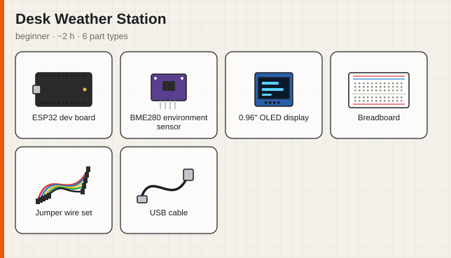 | beginner · ~2 h |  |
| 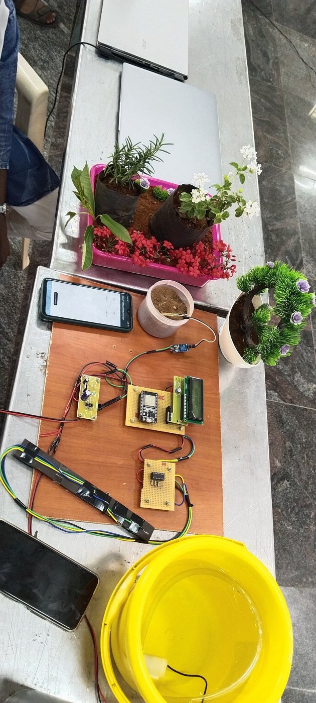<br><sub>A similar real build: an automatic plant-watering system</sub> | **Plant Watering Buddy**<br>An ESP32 watches the soil moisture of one plant, waters it with a tiny pump when it gets dry and shows the moisture history on a web page on your Wi-Fi.<br>`--project plant-buddy` | 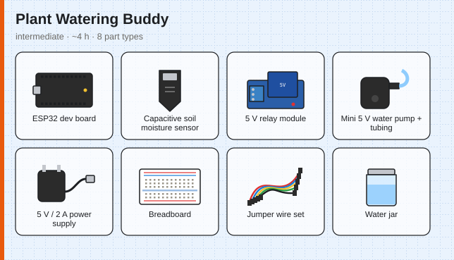 | intermediate · ~4 h |  |
| 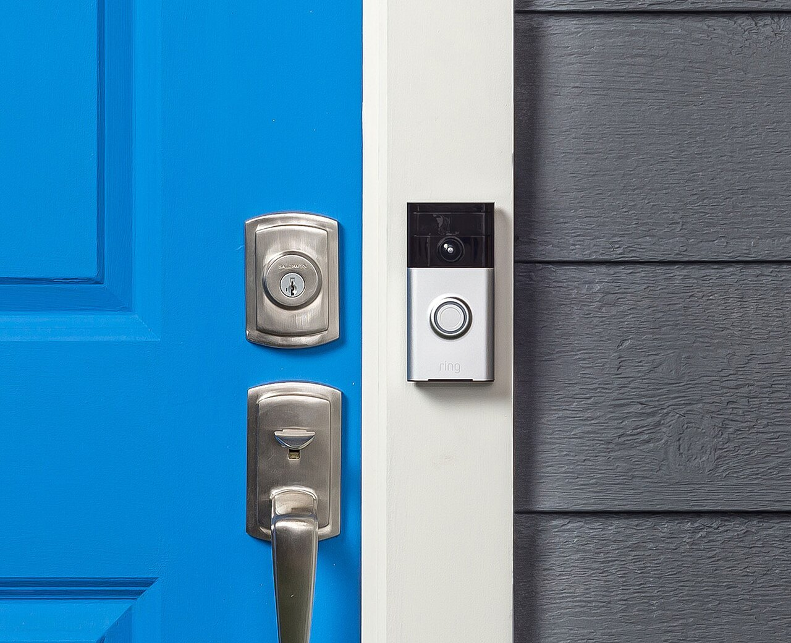<br><sub>A shop-bought video doorbell, the product this project rebuilds</sub> | **ESP32-CAM Video Doorbell**<br>A doorbell button with a tiny camera: when someone presses it, you get a phone notification with a photo of who's at the door.<br>`--project esp32cam-doorbell` | 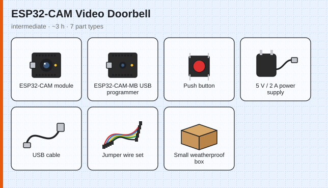 | intermediate · ~3 h |  |

Add your own: see [tutorial 4](docs/tutorials/04-customize-the-catalog.md#add-a-project-to-the-gallery).

## Tutorials

| # | Tutorial | |
|---|---|---|
| 1 | [Getting started](docs/tutorials/01-getting-started.md) | install, first run, API key, web UI |
| 2 | [From a photo to projects](docs/tutorials/02-photo-to-projects.md) | detect parts from a photo |
| 3 | [Constraints, checks and the shopping list](docs/tutorials/03-constraints-and-shopping-list.md) | how the self-check works |
| 4 | [Customize the catalog and the gallery](docs/tutorials/04-customize-the-catalog.md) | prices, part names, your own projects |
| 5 | [Build the Pi-hole Ad Blocker](docs/tutorials/05-build-pi-hole.md) | block ads for your whole home network |
| 6 | [Build the RFID Access Lock](docs/tutorials/06-build-rfid-lock.md) | full build + [Arduino code](examples/rfid-lock/rfid-lock.ino) |

## Example run

```bash
npm start -- "raspberry pi zero 2 w, microsd card, usb cable, phone charger, esp32, 0.96 oled, push button, breadboard, jumper wires" \
  --goal "protect my home network" --skill beginner --hours 2 --budget 300
```

> ℹ️ The output below was produced with `LLM_PROVIDER=mock`, so the projects come from the gallery instead
> of being invented by a model. Everything else (part matching, prices, constraint checks, the
> regeneration of the intermediate project that broke the `--skill beginner --hours 2` limits) is the real pipeline.
> **TODO before submitting:** run the same command with your API key and paste that output here.

```text
🛠  asking mock (offline, answers from the gallery) for 3 projects using 9 part type(s)…
↻ 1 project(s) broke a constraint — regenerating: "Home VPN with WireGuard": skill — difficulty intermediate (yours: beginner), time — 2.5 h (limit 2 h)

━━━ 1. Pi-hole Ad Blocker ━━━━━━━━━━━━━━━━━━━━━━━━━━━━━━━━━━━━━━━━━━━━━━━━━━━━━━━━━━━━━━━━━━━━━━━━━━
A tiny Raspberry Pi that blocks ads and trackers for every device on your home Wi-Fi (phones,
laptops, smart TVs) by acting as your network's DNS server.
beginner · ~1.5 h · solderless · you own 100% of the parts · nothing priced to buy

Parts
  ✓ 1× Raspberry Pi Zero 2 W — runs Pi-hole 24/7 (any Raspberry Pi works)
  ✓ 1× microSD card (16 GB+) — operating system and blocklists
  ✓ 1× 5 V / 2 A power supply — keeps the Pi running
  ✓ 1× USB cable — power cable for the Pi

Steps
   1. Flash the SD card — In Raspberry Pi Imager choose Raspberry Pi OS Lite (64-bit). In the
      settings set a hostname (pihole), your Wi-Fi, a username and password, and enable SSH. Write
      the card.
   2. Boot and connect — Put the card in the Pi, power it, wait two minutes, then from your computer
      run: ssh <username>@pihole.local
   3. Give it a fixed address — In your router's admin page, find the Pi in the list of connected
      devices and add a DHCP reservation, so its IP address never changes.
   4. Install Pi-hole — Update first (sudo apt update && sudo apt full-upgrade -y), then run the
      official installer: curl -sSL https://install.pi-hole.net | bash. Accept the defaults and note
      the admin address it shows at the end.
   5. Set the admin password — Run sudo pihole setpassword, then open http://pihole.local/admin in a
      browser and log in to the dashboard.
   6. Point your network at it — In the router's DHCP/DNS settings, set the Pi's IP address as the
      only DNS server. Reconnect your devices to Wi-Fi so they pick up the change.
   7. Test and tune — Open a news site: ads should be gone and the dashboard's 'Queries blocked'
      counter should rise. If a site breaks, find its domain in Query Log and click Allow.

Safety
  ! If the Pi is off, websites stop loading for everyone. Plug it into a reliable socket, or keep a
    note of how to switch the router's DNS back.
  ! Don't add a public DNS server as a second DNS in the router: devices would use it to go around
    Pi-hole.

Checks  ✓ skill  ✓ time  ✓ budget  ✓ uses-your-parts

━━━ 2. Hardware Password Generator ━━━━━━━━━━━━━━━━━━━━━━━━━━━━━━━━━━━━━━━━━━━━━━━━━━━━━━━━━━━━━━━━━
Press a button, get a strong random password or passphrase on a small screen, made by the ESP32's
hardware random-number generator. Nothing is stored or sent anywhere.
beginner · ~1.5 h · solderless · you own 92% of the parts · ~3 CZK to buy

Parts
  ✓ 1× ESP32 dev board — hardware random-number generator
  ✓ 1× 0.96" OLED display (SSD1306, I2C) — shows the password
  ◐ 2× Push button have 1, MISSING 1 (~3 CZK) — new password / switch mode
  ✓ 1× Breadboard — prototyping
  ✓ 1× Jumper wire set — wiring
  ✓ 1× USB cable — power

Steps
   1. Wire it — OLED on I2C (SDA→GPIO21, SCL→GPIO22, VCC→3V3, GND→GND). Buttons from GPIO4 and GPIO5
      to GND, INPUT_PULLUP.
   2. Use real randomness — Call esp_random() for random numbers. It is a true hardware RNG while
      Wi-Fi or Bluetooth is on; with radios off, call bootloader_random_enable() first.
   3. Pick characters fairly — For each character, draw a random number and reject it if it falls
      above the largest multiple of your alphabet size (rejection sampling), so no character is more
      likely than another.
   4. Passphrase mode — The second button switches to 5 random words from a word list (for example
      the EFF short word list stored in flash): easier to type, still strong.
   5. Show the strength — Display the length and the entropy in bits (length × log2(alphabet size)).
      Aim for at least 80 bits.

Safety
  ! Type the password straight into your password manager and press the button again so it
    disappears from the screen.

Checks  ✓ skill  ✓ time  ✓ budget  ✓ uses-your-parts

━━━ 3. Desk Weather Station ━━━━━━━━━━━━━━━━━━━━━━━━━━━━━━━━━━━━━━━━━━━━━━━━━━━━━━━━━━━━━━━━━━━━━━━━
A tiny OLED dashboard showing temperature, humidity and pressure with a 'rain coming?' trend arrow
based on the pressure change over 3 hours.
beginner · ~2 h · solderless · you own 83% of the parts · ~150 CZK to buy

Parts
  ✓ 1× ESP32 dev board — reads the sensor, drives the display
  ✗ 1× BME280 environment sensor MISSING (~150 CZK) — temperature, humidity, pressure
  ✓ 1× 0.96" OLED display (SSD1306, I2C) — shows the readings
  ✓ 1× Breadboard — prototyping
  ✓ 1× Jumper wire set — wiring
  ✓ 1× USB cable — power

Steps
   1. Share the I2C bus — Both modules: VCC→3V3, GND→GND, SDA→GPIO21, SCL→GPIO22. They have
      different addresses (BME280 0x76, OLED 0x3C), so they can share the two wires.
   2. Scan the bus — Upload an I2C scanner sketch and check both addresses appear in the Serial
      Monitor before writing any other code.
   3. Read the sensor — Use the Adafruit BME280 library; read every 5 s. Note: a sensor mounted
      right next to the ESP32 reads 1–2 °C warm — keep them a few cm apart.
   4. Draw the dashboard — With Adafruit SSD1306: big temperature on top, humidity and pressure
      below, and an arrow (↑ / → / ↓) for the pressure trend.
   5. Pressure trend — Store one pressure sample every 10 minutes in an 18-slot ring buffer (3
      hours). A drop of more than 3 hPa over 3 hours means weather is likely getting worse.

Checks  ✓ skill  ✓ time  ✓ budget  ✓ uses-your-parts

• Replaced "Home VPN with WireGuard" (skill, time) with "Desk Weather Station".
Model: mock (offline, answers from the gallery) · 2 LLM calls
```

## How it works

1. **Parse inventory** (`src/core/inventory.ts`) — split the list, read quantities, map each name to a canonical key (`src/core/catalog.ts`) and merge duplicates.
2. *(optional)* **Detect parts from a photo** — one vision call returns `{parts: [{name, qty}]}`; the user confirms.
3. **Generate** (`src/core/generate.ts`) — system prompt with design rules (`src/core/prompts.ts`), user prompt with inventory, constraints and the catalog's canonical names + prices. Output is constrained by a JSON Schema and validated with zod; on failure the validator's errors go back to the model (up to 2 repairs).
4. **Enrich in code** — diff each project's bill of materials against the inventory, compute coverage and the cost of missing parts.
5. **Verify** — check skill, time, budget, soldering, "uses your parts" and a mains-voltage safety rule. Failing projects are regenerated once with the reasons and a "don't repeat these" list.
6. **Rank & output** — fewest broken constraints first, then most parts owned, then cheapest.

All HTTP calls go through `withRetry()` (`src/core/retry.ts`).

```
src/
  core/
    schemas.ts     zod + JSON Schemas, result types
    config.ts      env loading & validation
    catalog.ts     name normalization + alias matching
    inventory.ts   quantity parsing, inventory, owned/missing diff
    prompts.ts     system + user prompts
    llm.ts         Anthropic / OpenAI-compatible clients (fetch), strict-schema conversion
    retry.ts       backoff + jitter, transient-error classification
    generate.ts    repair loop, enrichment, constraint checks, regeneration
    illustrate.ts  SVG parts pictures (component icons, owned/missing)
    showcase.ts    loads the gallery
    mock.ts        offline provider (answers from the gallery)
  cli/             argument parsing, terminal formatting, gallery, shopping list
  web/             node:http server + single-page UI (make / gallery / how it works)
data/parts-catalog.json   aliases + indicative CZK prices (edit freely)
data/showcase.json        the 20 gallery projects
docs/                     tutorials + screenshots + generated pictures
examples/                 Arduino / Python code for the tutorial builds
scripts/render-gallery.ts regenerates docs/images (npm run gallery:images)
test/                     node:test suites
```

## Mapping to the assignment

| Requirement | Where |
|---|---|
| Input: list + optional constraints (any subset) | parts list / `--photo` + `--goal --skill --hours --budget --no-solder` |
| Output: title, full list marking missing items, steps, time | every project card: ✓/◐/✗ parts list, numbered steps, `~N h` |
| Error handling | config, argument, HTTP, validation and file errors each get a clear message and exit code |
| ≥ 1 retry on transient API failures | `src/core/retry.ts` — up to `LLM_MAX_RETRIES` (default 3) with backoff |
| API key in env var, not committed | `.env` (git-ignored), `.env.example` template |
| CLI; minimal web UI is a bonus | `npm start`, `npm run web` (with gallery and photo upload) |
| README with setup, env vars, example run | this file |

## Tests

```bash
npm test          # 29 tests, no network, no API key needed
npm run typecheck
```

## Limitations

- Prices are indicative hobby-shop prices for the Czech market; edit `data/parts-catalog.json`.
- Part matching only knows parts in the catalog; unknown parts still match each other by normalized name, but synonyms of unknown parts won't.
- Time estimates come from the model and are checked against your limit, not measured.
- The parts pictures are generated illustrations (component icons), not photos of real builds.
- The example code (`examples/`) is compile-checked; gallery photos show the finished result or a similar real build, not this exact one. Add photos of your own builds to `docs/images/` once you build them.
