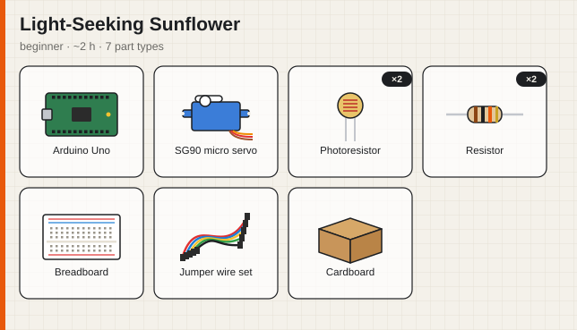
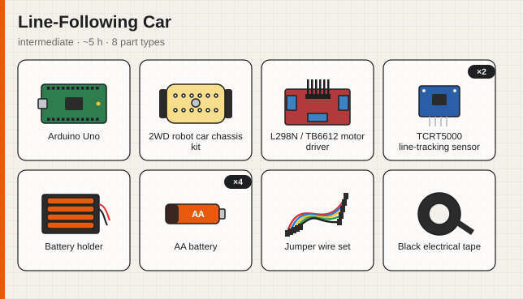
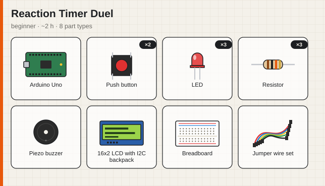
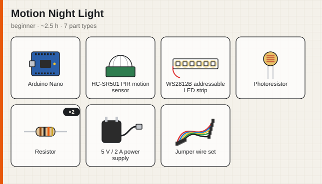

# PartsBin — Parts-to-Projects

Tell PartsBin which electronics parts are lying in your drawer (or just **show it a photo**), add a few
constraints, and it designs **three buildable DIY projects** for you — each with a full parts list that
marks what you already own and what you'd have to buy, step-by-step build instructions, an estimated
build time and a price for the missing parts.

It's the "Fridge-to-Recipes" homework with a different fridge: **parts instead of ingredients, projects
instead of recipes** — plus a few things that make it more than a prompt wrapped in a CLI.

```
parts you own ─┐                     ┌─ 3 projects, each with:
photo of bin ──┼──▶  LLM  ──▶ verify ┼─   ✓ owned / ✗ missing parts (+ CZK price)
constraints ───┘      ▲          │   ├─   step-by-step build instructions
                      └─ repair /─┘   ├─   estimated build time
                         regenerate   └─   constraint checks + shopping list
```


**New here?** Start with the [tutorials](docs/README.md), or browse the [gallery](#gallery) below.

## Features

| | |
|---|---|
| 📷 **Photo → parts list** | A vision call detects components in a photo of your parts bin. You confirm or edit the list before anything is generated. |
| 🧮 **Missing parts computed in code, not by the LLM** | Every part name (yours and the model's) is mapped to a canonical key through an alias catalog (`"9g micro servo"`, `"SG90"` and `"servo"` are the same part, but `"MG996R servo"` isn't). Quantities count: own 2 servos, need 4 → *have 2, missing 2*. |
| 💰 **Cost of missing parts** | Indicative CZK prices from an editable catalog (`data/parts-catalog.json`). Unknown items (popsicle sticks…) are listed as unpriced instead of guessed. |
| ✅ **Self-check loop** | After generation the app verifies every constraint itself (skill, time, budget, soldering, "uses your parts", mains-voltage safety). Projects that fail are regenerated *individually* with the reasons fed back to the model; the better version is kept. |
| 🧾 **Validated structured output** | The model answers in JSON Schema-constrained output; [zod](https://zod.dev) validates it. Invalid output is sent back with the validation errors so the model can repair it. |
| 🔁 **Retries done properly** | Exponential backoff with full jitter on transient failures only (429, 5xx, 529 overloaded, timeouts, network errors), honours `Retry-After`. Permanent errors (401 bad key, 400, 404 model) fail immediately with a helpful message. |
| 🔌 **Provider-agnostic** | Anthropic (default), any OpenAI-compatible API (OpenAI, OpenRouter, Groq, local Ollama…), or an offline **mock** provider for trying it without a key. No LLM SDK — the HTTP layer is ~150 lines of `fetch`. |
| 🖼 **Parts pictures** | Every project, including ones the AI just invented, gets a generated illustration of its parts: solid cards for what you own, dashed red "BUY ~60 Kč" cards for what's missing. 60+ hand-drawn component icons. |
| 📚 **Gallery of 10 example projects** | Curated, fully written builds (walking robots, a theremin, a radar, a plant-watering IoT gadget…), ranked against *your* parts. Works offline, no API key. |
| 📘 **Tutorials + example code** | Six step-by-step guides, including two complete builds with Arduino and Python code ([docs](docs/README.md)). |
| 🖥 **CLI + web UI** | Coloured terminal output, `--json`, Markdown shopping-list export, SVG export, and a web UI with photo drag-and-drop, a gallery and a "how it works" page. |
| 🧪 **Tested** | 29 unit tests: part matching, quantity parsing, retry/backoff, repair loop, constraint regeneration, HTTP client against a stubbed `fetch`, gallery data, illustrations. |

## Setup

Requires **Node.js 20.12+** (uses built-in `fetch`, `process.loadEnvFile` and `node:test`).

```bash
git clone <this repo> && cd partsbin
npm install
cp .env.example .env      # then put your API key into .env
```

Try it without any key first:

```bash
LLM_PROVIDER=mock npm start -- "arduino uno, 4x sg90, hc-sr04" --skill beginner
```

(Windows PowerShell: `$env:LLM_PROVIDER="mock"; npm start -- "arduino uno, 4x sg90, hc-sr04" --skill beginner`.)
The mock provider answers from the gallery, so it's also the fastest way to demo the app.

## Environment variables

Configuration lives in `.env` (loaded automatically, **git-ignored — never commit it**). `.env.example` is the template.

| Variable | Required | Default | Meaning |
|---|---|---|---|
| `LLM_PROVIDER` | no | `anthropic` | `anthropic`, `openai` (any OpenAI-compatible API) or `mock` (offline) |
| `ANTHROPIC_API_KEY` | if provider = anthropic | — | Your Anthropic API key |
| `OPENAI_API_KEY` | if provider = openai¹ | — | API key for the OpenAI-compatible server |
| `OPENAI_BASE_URL` | no | `https://api.openai.com/v1` | e.g. `http://localhost:11434/v1` for Ollama |
| `LLM_MODEL` | if provider = openai | `claude-sonnet-5-5` for anthropic | Model name |
| `LLM_TIMEOUT_MS` | no | `60000` | Timeout per request attempt |
| `LLM_MAX_RETRIES` | no | `3` | Retries after the first attempt (transient errors only) |
| `PORT` | no | `3000` | Web UI port |

¹ Not needed for local servers like Ollama.

## Usage

### CLI

```bash
npm start -- [parts...] [options]
# or, after `npm link`:  partsbin [parts...] [options]
```

| Option | |
|---|---|
| `"arduino uno, 4x sg90, …"` | Parts, comma / newline separated. Quantities: `4x servo`, `servo x4`, `servo (4)`, `4 servos` |
| `--parts-file <file>` | Text file, one part per line |
| `--photo <image>` | Detect parts from a photo (jpg/png/webp/gif). Asks you to confirm; `--yes` skips that |
| `--goal <text>` | Theme, e.g. `"something that walks"` |
| `--skill <level>` | `beginner` \| `intermediate` \| `advanced` |
| `--hours <n>` | Max build time |
| `--budget <czk>` | Max spend on missing parts |
| `--no-solder` | Solderless builds only |
| `--gallery` | List the example projects, ranked by your parts if you give any (no API key needed) |
| `--project <id>` | Show one example project in full, checked against your parts |
| `--json` | Raw JSON output |
| `--shopping-list <file>` | Write a Markdown shopping list |
| `--svg-dir <dir>` | Save a parts picture (SVG) for every project |
| `--provider <name>` | Override `LLM_PROVIDER` for one run |

Exit codes: `0` success, `1` runtime/API error, `2` bad arguments.

### Web UI

```bash
npm run web        # → http://localhost:3000
```

Type or photograph your parts (or click one of the example kits), set constraints, and get three project
cards with a parts picture, owned/missing parts, steps, constraint checks and a downloadable shopping list.
The **Gallery** tab shows the example projects ranked against your parts; **How it works** explains the cards.

| Gallery | Project from the gallery | On a phone |
|---|---|---|
|  |  |  |

The terminal version:

| `npm start -- "…parts…" --skill beginner …` | `npm start -- --gallery "…parts…"` |
|---|---|
|  |  |

## Gallery

Ten curated example projects ship with the app (`data/showcase.json`). See them with `npm start -- --gallery`
or in the web UI. Each one is a complete build: parts with purposes, numbered steps with pins, time, difficulty
and safety notes.

| | Project | Level | Time | Guide |
|---|---|---|---|---|
|  | **Desk Crab — a 4-servo walking robot**<br>A palm-sized quadruped that shuffles across your desk and backs away from obstacles it 'sees' with the ultrasonic sensor.<br>`--project desk-crab` | intermediate | ~6 h |  |
|  | **Air Theremin**<br>Play notes by moving your hand above an ultrasonic sensor; a potentiometer picks the musical scale.<br>`--project air-theremin` | beginner | ~2 h | [📘 build guide](docs/tutorials/05-build-air-theremin.md) |
|  | **Ultrasonic Radar Sweep**<br>A servo sweeps the ultrasonic sensor back and forth and your laptop draws a live radar screen of nearby objects.<br>`--project radar-sweep` | beginner | ~3 h | [📘 build guide](docs/tutorials/06-build-radar-sweep.md) |
|  | **Light-Seeking Sunflower**<br>A servo turns a cardboard flower toward the brightest light using two light sensors.<br>`--project sunflower` | beginner | ~2 h |  |
|  | **Plant Watering Buddy**<br>An ESP32 watches the soil moisture of one plant, waters it with a tiny pump when it gets dry and shows the moisture history on a web page on your Wi-Fi.<br>`--project plant-buddy` | intermediate | ~4 h |  |
|  | **Line-Following Car**<br>A two-wheeled robot car that follows a black tape track on the floor using two infrared line sensors.<br>`--project line-follower` | intermediate | ~5 h |  |
|  | **Desk Weather Station**<br>A tiny OLED dashboard showing temperature, humidity and pressure with a 'rain coming?' trend arrow based on the pressure change over 3 hours.<br>`--project weather-station` | beginner | ~2 h |  |
|  | **Reaction Timer Duel**<br>A two-player reflex game: wait for the green LED, slam your button first. The LCD shows who won and both reaction times in milliseconds.<br>`--project reaction-duel` | beginner | ~2 h |  |
|  | **Motion Night Light**<br>A warm LED strip under the bed or along the hallway that fades on when you walk past in the dark — and stays off during the day.<br>`--project night-light` | beginner | ~2.5 h |  |
|  | **Mini Biped Walker**<br>A small two-legged robot with hips and ankles that waddles forward, dances and turns away from walls — a first step towards a bigger walking robot.<br>`--project mini-biped` | intermediate | ~8 h |  |

Add your own: see [tutorial 4](docs/tutorials/04-customize-the-catalog.md#add-a-project-to-the-gallery).

## Tutorials

| # | Tutorial | |
|---|---|---|
| 1 | [Getting started](docs/tutorials/01-getting-started.md) | install, first run, API key, web UI |
| 2 | [From a photo to projects](docs/tutorials/02-photo-to-projects.md) | detect parts from a photo |
| 3 | [Constraints, checks and the shopping list](docs/tutorials/03-constraints-and-shopping-list.md) | how the self-check works |
| 4 | [Customize the catalog and the gallery](docs/tutorials/04-customize-the-catalog.md) | prices, part names, your own projects |
| 5 | [Build the Air Theremin](docs/tutorials/05-build-air-theremin.md) | full build + [Arduino code](examples/air-theremin/air-theremin.ino) |
| 6 | [Build the Ultrasonic Radar](docs/tutorials/06-build-radar-sweep.md) | full build + [Arduino](examples/radar-sweep/radar-sweep.ino) & [Python](examples/radar-sweep/radar_viewer.py) code |

## Example run

```bash
npm start -- "arduino uno, 2x sg90 servo, hc-sr04, breadboard, jumper wires, 10k potentiometer" \
  --goal "something that moves or makes noise" --skill beginner --hours 4 --budget 300
```

> ℹ️ The output below was produced with `LLM_PROVIDER=mock`, so the projects come from the gallery instead
> of being invented by a model. Everything else (part matching, prices, constraint checks, the
> regeneration of the 6-hour intermediate project that broke the `--skill beginner --hours 4` limits) is the real pipeline.
> **TODO before submitting:** run the same command with your API key and paste that output here.

```text
🛠  asking mock (offline, answers from the gallery) for 3 projects using 6 part type(s)…
↻ 1 project(s) broke a constraint — regenerating: "Desk Crab — a 4-servo walking robot": skill — difficulty intermediate (yours: beginner), time — 6 h (limit 4 h)

━━━ 1. Air Theremin ━━━━━━━━━━━━━━━━━━━━━━━━━━━━━━━━━━━━━━━━━━━━━━━━━━━━━━━━━━━━━━━━━━━━━━━━━━━━━━━━
Play notes by moving your hand above an ultrasonic sensor; a potentiometer picks the musical scale.
beginner · ~2 h · solderless · you own 83% of the parts · ~15 CZK to buy

Parts
  ✓ 1× Arduino Uno — reads distance, generates tones
  ✓ 1× HC-SR04 ultrasonic sensor — measures hand height
  ✗ 1× Piezo buzzer MISSING (~15 CZK) — sound output
  ✓ 1× Potentiometer (10k) — scale / octave selector
  ✓ 1× Breadboard — prototyping
  ✓ 1× Jumper wire set — wiring

Steps
   1. Wire the sensor — HC-SR04: VCC→5V, GND→GND, TRIG→D9, ECHO→D10.
   2. Wire the buzzer and pot — Buzzer + to D8, − to GND. Potentiometer outer legs to 5V and GND,
      wiper to A0.
   3. Measure distance — Send a 10 µs TRIG pulse, read ECHO with pulseIn(), convert to cm (duration
      / 58). Clamp to 5–50 cm.
   4. Map distance to notes — Split 5–50 cm into 8 zones and map each to a note of the selected
      scale (major, minor, pentatonic — chosen by the pot reading).
   5. Play — Call tone(8, frequency) when the note changes; noTone(8) when no hand is detected for
      300 ms.
   6. Smooth it — Average the last 5 readings so the pitch doesn't jitter between notes.

Checks  ✓ skill  ✓ time  ✓ budget  ✓ uses-your-parts

━━━ 2. Ultrasonic Radar Sweep ━━━━━━━━━━━━━━━━━━━━━━━━━━━━━━━━━━━━━━━━━━━━━━━━━━━━━━━━━━━━━━━━━━━━━━
A servo sweeps the ultrasonic sensor back and forth and your laptop draws a live radar screen of
nearby objects.
beginner · ~3 h · solderless · you own 83% of the parts · ~60 CZK to buy

Parts
  ✓ 1× Arduino Uno — controls the sweep and takes readings
  ✓ 1× SG90 micro servo — pans the sensor 15–165°
  ✓ 1× HC-SR04 ultrasonic sensor — distance at each angle
  ✓ 1× Breadboard — prototyping
  ✓ 1× Jumper wire set — wiring
  ✗ 1× USB cable MISSING (~60 CZK) — serial link to the laptop

Steps
   1. Mount the sensor — Glue or tape the HC-SR04 onto the servo horn so it rotates with it.
   2. Wire it up — Servo signal→D9, servo power→5V/GND (one SG90 is fine on USB power). HC-SR04
      TRIG→D10, ECHO→D11.
   3. Sweep and measure — Loop the servo from 15° to 165° and back in 2° steps; at each step wait 30
      ms, then measure distance.
   4. Stream the data — Print 'angle,distance' lines over Serial at 115200 baud.
   5. Draw the radar — Run the Python viewer (pyserial + matplotlib polar plot) that reads the lines
      and draws fading green dots.
   6. Calibrate — Place an object at a measured 30 cm and check the plot; adjust the speed-of-sound
      constant if it's off.

Checks  ✓ skill  ✓ time  ✓ budget  ✓ uses-your-parts

━━━ 3. Light-Seeking Sunflower ━━━━━━━━━━━━━━━━━━━━━━━━━━━━━━━━━━━━━━━━━━━━━━━━━━━━━━━━━━━━━━━━━━━━━
A servo turns a cardboard flower toward the brightest light using two light sensors.
beginner · ~2 h · solderless · you own 57% of the parts · ~12 CZK to buy (+ 1 household item)

Parts
  ✓ 1× Arduino Uno — compares the two light readings
  ✓ 1× SG90 micro servo — turns the flower
  ✗ 2× Photoresistor (LDR) MISSING (~10 CZK) — left/right light sensors
  ✗ 2× Resistor MISSING (~2 CZK) — 10k voltage dividers for the LDRs
  ✓ 1× Breadboard — prototyping
  ✓ 1× Jumper wire set — wiring
  ✗ 1× Cardboard MISSING — the flower

Steps
   1. Build two dividers — Each LDR from 5V to A0/A1, with a 10k resistor from that pin to GND.
   2. Wire the servo — Signal→D9, power→5V/GND.
   3. Steer toward light — If A0 − A1 > 20, move the servo 1° left; if < −20, 1° right. Repeat every
      20 ms.
   4. Add a dead zone — Ignore differences smaller than the threshold so the flower doesn't twitch;
      tune it in a room with even light.
   5. Decorate — Glue a cardboard flower to the servo horn with the LDRs on either side of the face,
      separated by a small cardboard divider so each one 'sees' its own side.

Checks  ✓ skill  ✓ time  ✓ budget  ✓ uses-your-parts

• Replaced "Desk Crab — a 4-servo walking robot" (skill, time) with "Light-Seeking Sunflower".
Model: mock (offline, answers from the gallery) · 2 LLM calls
```

## How it works

1. **Parse inventory** (`src/core/inventory.ts`) — split the list, read quantities, map each name to a canonical key (`src/core/catalog.ts`) and merge duplicates.
2. *(optional)* **Detect parts from a photo** — one vision call returns `{parts: [{name, qty}]}`; the user confirms.
3. **Generate** (`src/core/generate.ts`) — system prompt with design rules (`src/core/prompts.ts`), user prompt with inventory, constraints and the catalog's canonical names + prices. Output is constrained by a JSON Schema and validated with zod; on failure the validator's errors go back to the model (up to 2 repairs).
4. **Enrich in code** — diff each project's bill of materials against the inventory, compute coverage and the cost of missing parts.
5. **Verify** — check skill, time, budget, soldering, "uses your parts" and a mains-voltage safety rule. Failing projects are regenerated once with the reasons and a "don't repeat these" list.
6. **Rank & output** — fewest broken constraints first, then most parts owned, then cheapest.

All HTTP calls go through `withRetry()` (`src/core/retry.ts`).

```
src/
  core/
    schemas.ts     zod + JSON Schemas, result types
    config.ts      env loading & validation
    catalog.ts     name normalization + alias matching
    inventory.ts   quantity parsing, inventory, owned/missing diff
    prompts.ts     system + user prompts
    llm.ts         Anthropic / OpenAI-compatible clients (fetch), strict-schema conversion
    retry.ts       backoff + jitter, transient-error classification
    generate.ts    repair loop, enrichment, constraint checks, regeneration
    illustrate.ts  SVG parts pictures (component icons, owned/missing)
    showcase.ts    loads the gallery
    mock.ts        offline provider (answers from the gallery)
  cli/             argument parsing, terminal formatting, gallery, shopping list
  web/             node:http server + single-page UI (make / gallery / how it works)
data/parts-catalog.json   aliases + indicative CZK prices (edit freely)
data/showcase.json        the 10 gallery projects
docs/                     tutorials + screenshots + generated pictures
examples/                 Arduino / Python code for the tutorial builds
scripts/render-gallery.ts regenerates docs/images (npm run gallery:images)
test/                     node:test suites
```

## Mapping to the assignment

| Requirement | Where |
|---|---|
| Input: list + optional constraints (any subset) | parts list / `--photo` + `--goal --skill --hours --budget --no-solder` |
| Output: title, full list marking missing items, steps, time | every project card: ✓/◐/✗ parts list, numbered steps, `~N h` |
| Error handling | config, argument, HTTP, validation and file errors each get a clear message and exit code |
| ≥ 1 retry on transient API failures | `src/core/retry.ts` — up to `LLM_MAX_RETRIES` (default 3) with backoff |
| API key in env var, not committed | `.env` (git-ignored), `.env.example` template |
| CLI; minimal web UI is a bonus | `npm start`, `npm run web` (with gallery and photo upload) |
| README with setup, env vars, example run | this file |

## Tests

```bash
npm test          # 29 tests, no network, no API key needed
npm run typecheck
```

## Limitations

- Prices are indicative hobby-shop prices for the Czech market; edit `data/parts-catalog.json`.
- Part matching only knows parts in the catalog; unknown parts still match each other by normalized name, but synonyms of unknown parts won't.
- Time estimates come from the model and are checked against your limit, not measured.
- The parts pictures are generated illustrations (component icons), not photos of real builds.
- The gallery's example code (`examples/`) is compile-checked; the builds follow standard wiring for these modules but haven't been photographed yet. Add photos of your own builds to `docs/images/` once you build them.
