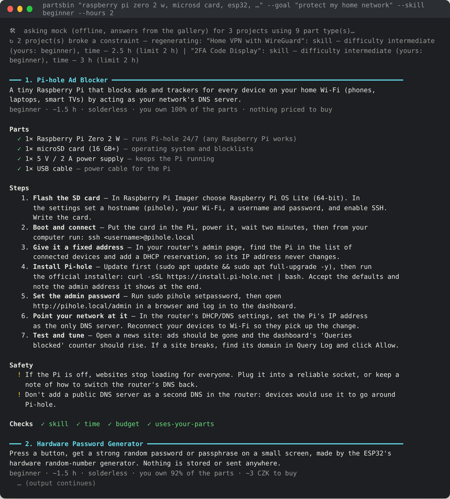
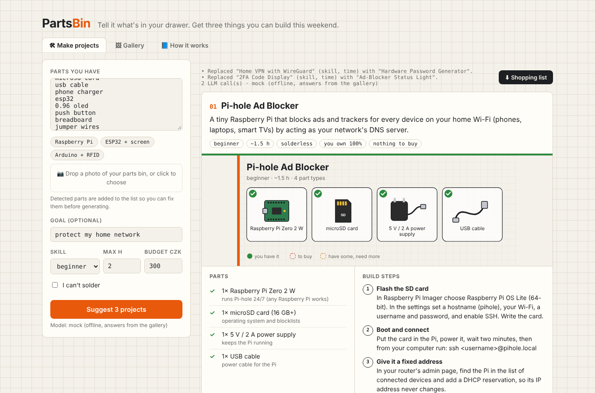
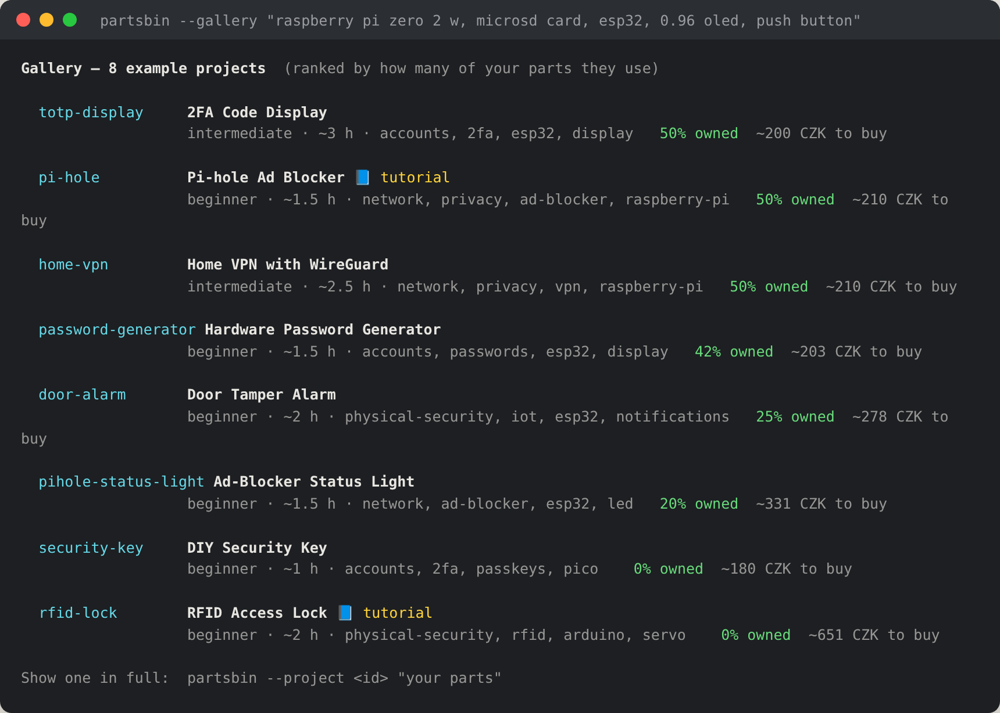

# 1 · Getting started

**Time:** 10 minutes · **You need:** Node.js 20.12 or newer, a terminal, optionally an Anthropic (or OpenAI-compatible) API key.

By the end you'll have PartsBin running in the terminal and in the browser, first without an API key, then with a real model.

---

## Step 1: Install

```bash
git clone <your repo url> partsbin
cd partsbin
npm install
```

Check that everything works by running the tests. They need no network and no key:

```bash
npm test
```

You should see `ℹ pass` with every test passing.

## Step 2: First run without a key (mock mode)

Mock mode answers from the built-in [gallery](../../data/showcase.json) instead of calling an AI. It's perfect for trying the app, demos and tests.

```bash
# macOS / Linux
LLM_PROVIDER=mock npm start -- "raspberry pi zero 2 w, microsd card, usb cable, phone charger, esp32, 0.96 oled, push button, breadboard, jumper wires" --skill beginner --hours 2

# Windows PowerShell
$env:LLM_PROVIDER="mock"; npm start -- "raspberry pi zero 2 w, microsd card, usb cable, phone charger, esp32, 0.96 oled, push button, breadboard, jumper wires" --skill beginner --hours 2
```



Things to notice:

- **✓ / ◐ / ✗**: parts you own, own some of, or are missing. The price of missing parts comes from [`data/parts-catalog.json`](../../data/parts-catalog.json).
- **`↻ … broke a constraint — regenerating`**: the mock deliberately ignores your skill/time limits the first time, just like a real model sometimes does. The app catches it and asks for a replacement. That self-check is the core feature, see [tutorial 3](03-constraints-and-shopping-list.md).
- **Checks** at the bottom of each project: every constraint the app verified.

## Step 3: Add your API key

```bash
cp .env.example .env        # Windows: copy .env.example .env
```

Open `.env` and set:

```ini
LLM_PROVIDER=anthropic
ANTHROPIC_API_KEY=sk-ant-...
```

`.env` is in `.gitignore`, so it is never committed. Using OpenAI, OpenRouter, Groq or a local Ollama instead? Set `LLM_PROVIDER=openai`, `OPENAI_BASE_URL`, `OPENAI_API_KEY` and `LLM_MODEL` (see the README's environment table).

Now run without the `LLM_PROVIDER=mock` prefix:

```bash
npm start -- "raspberry pi zero 2 w, microsd card, usb cable, phone charger, esp32, 0.96 oled, push button, breadboard, jumper wires" --goal "protect my home network" --skill beginner --hours 2
```

This time the projects are designed by the model for your exact parts. A run takes about 10–40 seconds.

## Step 4: The web UI

```bash
npm run web          # then open http://localhost:3000
```



- Click **Raspberry Pi**, **ESP32 + screen** or **Arduino + RFID** to fill in an example parts list.
- Drop a photo of your parts on the dashed box to detect parts automatically ([tutorial 2](02-photo-to-projects.md)).
- **Gallery** shows the example projects (small security gadgets), ranked by how many of your parts they use.
- **⬇ Shopping list** downloads what you'd need to buy as a Markdown checklist.

## Step 5: Explore the gallery from the terminal

```bash
npm start -- --gallery "raspberry pi zero 2 w, esp32, oled"
npm start -- --project rfid-lock "arduino uno, sg90" --svg-dir pictures
```



`--svg-dir` saves a parts picture for each project. Open the `.svg` in any browser.

---

**Next:** [2 · From a photo to projects →](02-photo-to-projects.md)
