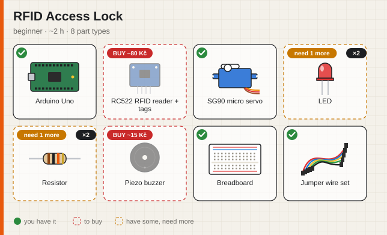

# 3 · Constraints, checks and the shopping list

**Time:** 10 minutes

Constraints are how you tell PartsBin what "a good project for me" means. This tutorial shows each one, how the app checks them, and what happens when a project breaks one.

---

## The constraints

All of them are optional. Use any combination.

| Flag (CLI) | Web field | What it means | How it's checked |
|---|---|---|---|
| `--goal "…"` | Goal | theme or idea, e.g. `"block ads on my network"`, `"protect my accounts"` | guides the model (not checked: it's a wish, not a rule) |
| `--skill beginner` | Skill | the hardest difficulty you want | project difficulty ≤ your level |
| `--hours 4` | Max h | total build time | `estimatedHours` ≤ limit |
| `--budget 300` | Budget CZK | money for parts you'd have to buy | sum of missing parts × catalog price ≤ budget |
| `--no-solder` | I can't solder | breadboard / jumper wires only | project must not require soldering |

Two checks always run:

- **uses-your-parts**: at least 40 % of the parts list is yours, or at least 3 different parts of yours are used. A project that needs you to buy everything isn't a "use what you have" project.
- **safety**: anything involving mains voltage (230 V / 110 V) fails unless your skill is `advanced`.

## Try it: watch a project get replaced

The mock provider makes this easy to see, because it ignores the limits on the first try:

```bash
LLM_PROVIDER=mock npm start -- "raspberry pi zero 2 w, microsd card, usb cable, phone charger, esp32, 0.96 oled, push button, breadboard, jumper wires" \
  --goal "protect my home network" --skill beginner --hours 2 --budget 300
```

```
↻ 1 project(s) broke a constraint — regenerating: "Home VPN with WireGuard": skill — difficulty intermediate (yours: beginner), time — 2.5 h (limit 2 h)
…
• Replaced "Home VPN with WireGuard" (skill, time) with "Desk Weather Station".
Model: mock (offline, answers from the gallery) · 2 LLM calls
```

What happened:

1. The model proposed 3 projects. One of them (the VPN) was too hard and too long for a beginner with 2 hours.
2. The app **computed** that from the structured answer. It doesn't ask the model "did you follow the rules?"
3. Only the bad project was sent back, with the exact reasons and a "don't repeat these titles" list.
4. The replacement passed, so it took the old project's place. If a replacement is *not* better, the original is kept and you'll see `Kept "…" — the replacement wasn't better.`
5. Finally the three projects are sorted: fewest failed checks first, then most parts owned, then cheapest.

With a real model you'll usually see **1 LLM call**, because good models mostly follow the rules. The check is the safety net for when they don't.

## Reading the parts list

```
Parts
  ✓ 1× Arduino Uno — checks the card and drives the latch
  ✓ 1× RC522 RFID reader + tags — reads the card or key fob
  ◐ 2× LED (5 mm) have 1, MISSING 1 (~2 CZK) — green = open, red = denied
  ✗ 1× Piezo buzzer MISSING (~15 CZK) — beeps
```

The matching is done in code ([`src/core/catalog.ts`](../../src/core/catalog.ts)), not by the model. It understands that `SG90`, `9g micro servo` and `servos` are the same part, but `MG996R servo` is a different one, and that `rc522` means the RFID reader kit. It also counts: you said `1x led`, the project needs 2, so 1 is missing.

The **parts picture** shows the same thing visually. Solid cards with a green check are yours, dashed red cards are to buy:



## The shopping list

```bash
npm start -- "arduino uno, sg90, 1x led, rc522" --shopping-list shopping.md
```

```markdown
## 1. RFID Access Lock

- [ ] 1× LED (5 mm) — ~2 CZK
- [ ] 2× Resistor — ~2 CZK
- [ ] 1× Piezo buzzer — ~15 CZK
- [ ] 1× Breadboard — ~70 CZK
- [ ] 1× Jumper wire set — ~70 CZK

**Total:** ~159 CZK
```

In the web UI, use **⬇ Shopping list** above the results. The checkboxes render as a real checklist on GitHub, in Obsidian and in most note apps.

> Prices are indicative hobby-shop prices in CZK. To use your own shop's prices, see [tutorial 4](04-customize-the-catalog.md).

## Machine-readable output

`--json` prints everything: inventory, constraints, projects with `have`/`missing` per part, `coverage`, `missingCostCzk` and every check with its details. Use it to build your own tools on top:

```bash
npm start -- "esp32, oled, push button" --json > result.json
```

---

**Next:** [4 · Customize the parts catalog →](04-customize-the-catalog.md)
