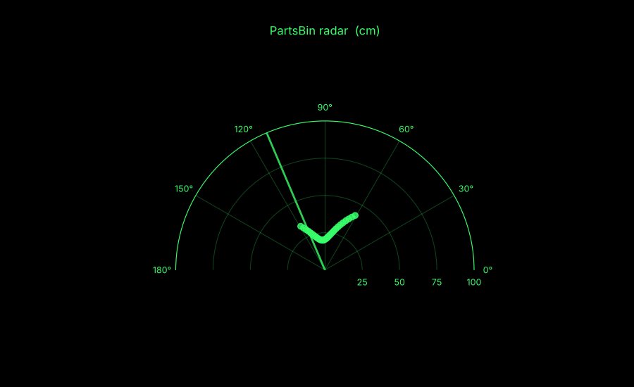

# 6 · Build the Ultrasonic Radar

**Difficulty:** beginner · **Time:** ~3 hours · **Soldering:** none

A servo swings an ultrasonic sensor left and right like a radar dish. The Arduino streams each angle and distance over USB, and a Python program on your computer draws a live, green, fading radar screen.

This is the gallery project `radar-sweep`. Check what you're missing with:

```bash
npm start -- --project radar-sweep "arduino uno, sg90, hc-sr04"
```


---

## Parts

| Part | Qty | Notes |
|---|---|---|
| Arduino Uno (or clone) | 1 | |
| SG90 micro servo | 1 | |
| HC-SR04 ultrasonic sensor | 1 | |
| Breadboard + jumper wires | 1 set | |
| USB cable | 1 | the one you program the Arduino with |
| Tape / hot glue / rubber band | | to mount the sensor on the servo |

On the computer: **Python 3.9+** with `pip install pyserial matplotlib`.

## Step 1: Mount the sensor on the servo

1. Put the longest servo horn (the "arm") on the servo but **don't screw it yet**.
2. Tape or glue the HC-SR04 onto the horn, eyes facing outward, so it turns with the servo.
3. Leave the sensor's 4 pins accessible and use female–male jumper wires to reach the breadboard. Give the wires enough slack for a 150° swing.
4. Tape or clamp the servo body to the table. It will shake when it moves.

## Step 2: Wiring

| From | To |
|---|---|
| Servo **orange / yellow** (signal) | D9 |
| Servo **red** (+) | 5V |
| Servo **brown / black** (−) | GND |
| HC-SR04 **VCC** | 5V |
| HC-SR04 **GND** | GND |
| HC-SR04 **TRIG** | D10 |
| HC-SR04 **ECHO** | D11 |

> One SG90 on USB power is fine. If the Arduino resets every time the servo moves, power the servo from a separate 5–6 V supply (4×AA) and connect that supply's − to Arduino GND.

## Step 3: Upload the Arduino sketch

[`examples/radar-sweep/radar-sweep.ino`](../../examples/radar-sweep/radar-sweep.ino) uses the built-in `Servo` library, so nothing needs installing.

1. Open it in the Arduino IDE, select your board and port, then **Upload**.
2. Open the Serial Monitor at **115200 baud**. You should see a steady stream:

```
15,48.3
17,48.1
19,-1.0
21,112.6
```

`-1.0` means "no echo" (nothing within ~2 m, or a surface at a steep angle).

3. **Close the Serial Monitor.** Only one program can use the port at a time.

## Step 4: Center the horn

While the sketch runs, the servo sweeps 15°–165°. Check the sensor faces **straight ahead at the middle of the sweep**. If not, unplug, move the horn one tooth, and screw it in.

## Step 5: Run the radar viewer

```bash
cd examples/radar-sweep
pip install pyserial matplotlib
python radar_viewer.py COM3                 # Windows: see Device Manager → Ports (COM & LPT)
python radar_viewer.py /dev/cu.usbmodem1101 # macOS:   ls /dev/cu.*
python radar_viewer.py /dev/ttyUSB0         # Linux:   ls /dev/ttyUSB* /dev/ttyACM*
```

A window opens with a half-circle radar. Objects appear as green dots that fade out after 4 seconds, and the green line shows where the sensor is pointing.



*The screenshot above was made with simulated serial data, to show the viewer itself.*

Options: `--range 200` to see up to 2 m, `--fade 2` for faster-fading dots.

## Step 6: Calibrate

1. Put a box exactly **30 cm** in front of the sensor (measure from the sensor's front face).
2. Read its distance in the viewer or the Serial Monitor.
3. If it's off by more than a centimetre, adjust `SPEED_OF_SOUND_CM_PER_US` in the sketch: multiply it by `30 / measured`. Sound is faster in warm air (~0.0346 at 25 °C) and slower in cold air (~0.0337 at 10 °C).

## Make it yours

| Idea | How |
|---|---|
| Finer picture | `STEP_DEG = 1` (slower sweep) |
| Faster sweep | `SETTLE_MS = 15`, `STEP_DEG = 3` |
| Intruder alarm | in the sketch, `tone()` a buzzer when anything is closer than 30 cm |
| Map a room | put it on the [Line-Following Car](../../data/showcase.json) and log `angle,distance` with the car's position |

## Troubleshooting

| Problem | Fix |
|---|---|
| `could not open port` | the Arduino IDE Serial Monitor is still open, or the wrong port name |
| Viewer window stays empty | wrong baud rate (must be 115200 in both), or the board is still resetting, so wait 2 s |
| Arduino resets / servo twitches | servo is drawing too much current. Use a separate supply for it (see step 2) |
| Lots of random far-away dots | soft surfaces (curtains, sofas) absorb sound. Test against hard objects first |

---

[← Back to all tutorials](../README.md)
